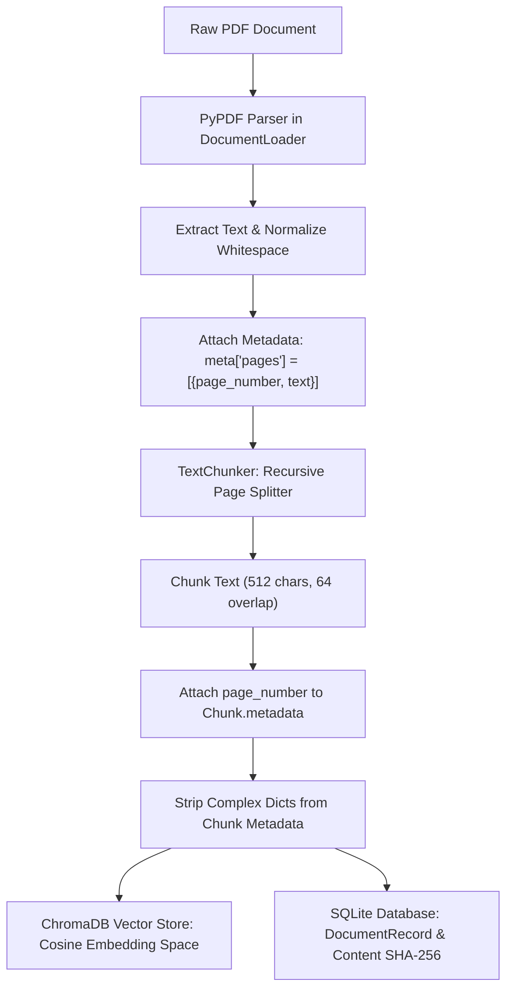
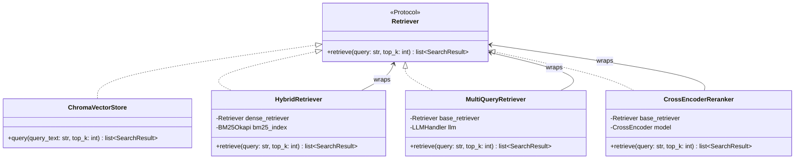
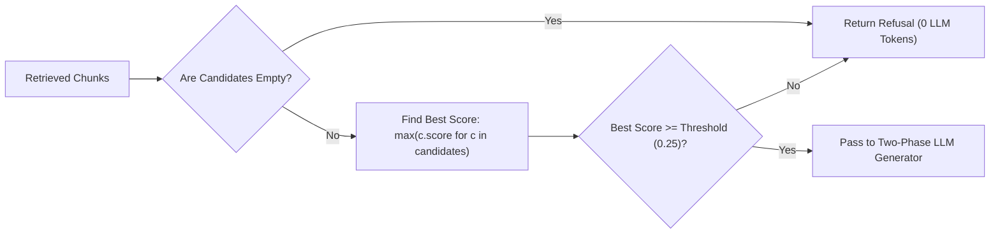

# 🏛️ System Architecture: AI Research Assistant RAG Pipeline

**Author / Developer**: **Mahadur Jaman Minto** | ID: `CE-180628`  
**Academic Supervisor**: **Dr. Mostofa Kamal Nasir**, Professor, Department of CSE  
**Institution**: Mawlana Bhashani Science and Technology University (MBSTU)  

> **Document Version**: 2.0 (Post-Phase 2 Hardening)  
> **Status**: Approved & Implemented in Production  
> **Architecture Pattern**: Hexagonal Architecture (Ports & Adapters) with Functional Composition  

---

## 1. Executive Summary & Design Principles

The **AI Research Assistant** is an enterprise-grade Retrieval-Augmented Generation (RAG) system engineered for high-precision question answering over academic and technical literature. It tackles the three fundamental limitations of naive RAG architectures:
1. **Hallucination & Unverifiable Assertions**: Solved via page-level PDF citation tracking, strict context grounding, and deterministic refusal gating for out-of-domain queries.
2. **Vocabulary Mismatch & Semantic Drift**: Solved via hybrid search combining sparse lexical retrieval (BM25) and dense semantic embeddings (ONNX `all-MiniLM-L6-v2`) fused with Reciprocal Rank Fusion (RRF $k=60$), followed by Cross-Encoder neural reranking.
3. **Opaque Latency & Runaway Costs**: Solved through two-pass streaming UX (Chain-of-Thought reasoning + final token generation over WebSockets) and per-query telemetry with an automated cost ledger.

```
+---------------------------------------------------------------------------------------+
|                                    React 19 Frontend                                  |
|   (Vite + TailwindCSS + Lucide Icons + WebSocket Streaming + Real-time Cost Badge)   |
+------------------------------------------+--------------------------------------------+
                                           | HTTP / WebSockets
                                           v
+---------------------------------------------------------------------------------------+
|                                    FastAPI Service                                    |
|              (/api/query, /api/upload, /api/documents, /api/eval, /ws/query)          |
+------------------------------------------+--------------------------------------------+
                                           | Injected Dependency
                                           v
+---------------------------------------------------------------------------------------+
|                                  RAGBackend (Facade)                                  |
|           Coordinates Ingestion, Query Orchestration, Relational State & Telemetry    |
+--------------------+---------------------+--------------------+-----------------------+
                     |                     |                    |
        +------------v-----------+         |         +----------v-----------+
        | Ingestion Subsystem    |         |         | SQLite Persistence   |
        | - DocumentLoader       |         |         | (SQLModel / Engine)  |
        | - PyPDF / python-docx  |         |         | - DocumentRecord     |
        | - TextChunker          |         |         | - Conversation       |
        +------------+-----------+         |         | - Message & Sources  |
                     |                     |         +----------------------+
                     v                     v
+---------------------------------------------------------------------------------------+
|                              QueryEngine & Retrieval Seam                             |
|                                                                                       |
|   User Query ──> [QueryRewriter] ──> [Retriever Seam] ──> [Cross-Encoder]             |
|                        │             ├─ Dense (Cosine)          │                     |
|                        │             └─ Hybrid (BM25+RRF)       │                     |
|                        v                                        v                     |
|                 [RefusalHandler] <────────────────────── Candidate Chunks             |
|                        │                                                              |
|        ┌───────────────┴───────────────┐                                              |
|        │ (Score < Threshold)           │ (Score >= Threshold)                         |
|        v                               v                                              |
|  Deterministic Refusal         Two-Pass Generator                                     |
|  ("I don't have enough...")    ├─ Step 1: CoT Reasoning (Fast LLM)                    |
|                                └─ Step 2: Answer Stream (Target LLM)                  |
+------------------------------------------+--------------------------------------------+
                                           |
                                           v
+---------------------------------------------------------------------------------------+
|                                LLM Provider Adapters                                  |
|   OpenAI (GPT-5/4o) | Google AI Studio (Gemini 2.5 Flash) | Anthropic | Ollama (Local) |
+---------------------------------------------------------------------------------------+
```

---

## 2. Ingestion Pipeline & Page-Level Provenance

Naive RAG systems drop page numbers during text extraction, forcing citations to cite arbitrary internal chunk indices. The AI Research Assistant maintains strict physical page provenance from PDF byte parsing to ChromaDB storage.



### Ingestion Invariants:
1. **Idempotent Ingestion**: `doc_id` is computed as `hashlib.sha256(raw_bytes).hexdigest()`. Re-uploading identical documents performs an upsert without duplicate vector creation.
2. **ChromaDB Compatibility**: ChromaDB metadata only supports scalar primitive types (`str`, `int`, `float`, `bool`). The ingestion seam strips hierarchical structures (`meta["pages"]`) while propagating `chunk_index` and `page_number` to chunk scalars.
3. **Table of Contents (ToC) Filtering**: `TextChunker` employs regex dot-leader filtering (`r"\.{4,}\s*\d+"`) to discard ToC index pages that pollute embedding similarity.

---

## 3. Retrieval Architecture & Seam Composition (ADR 0004 & ADR 0006)

The retrieval layer adheres to Hexagonal Architecture. The `Retriever` protocol specifies a single method: `retrieve(query: str, top_k: int) -> list[SearchResult]`. Every advanced retrieval lever is a decorator wrapping this seam.



### Hybrid Fusion: Reciprocal Rank Fusion (RRF $k=60$)
Cosine similarity and BM25 scores inhabit different spaces and distributions. Direct linear combination ($\alpha \cdot \text{Dense} + (1-\alpha) \cdot \text{BM25}$) is fragile and brittle across different corpora. We employ **Reciprocal Rank Fusion (RRF)**:

$$\text{RRF\_Score}(d \in D) = \sum_{m \in \{\text{dense}, \text{sparse}\}} \frac{1}{k + r_m(d)}$$

Where:
- $k = 60$ (standard Cormack et al. constant), preventing high-rank outliers from overpowering the fused score.
- $r_m(d)$ is the 1-based ordinal rank of document $d$ in retrieval method $m$.
- Chunks absent from one retrieval side contribute $0$ to that rank term.

---

## 4. Deterministic Refusal Gating (Phase 2 Lever 2g)

Standard RAG systems hallucinate when user queries fall outside the indexed corpus. In our architecture, the `RefusalHandler` sits between retrieval and generation.



- **Rank vs. Score Preservation**: Because Hybrid Retrieval ranks chunks by fused RRF order rather than descending cosine similarity, the gate inspects $\max(c.\text{score})$ across the candidate set, avoiding false refusals on sparse-first ranks.

---

## 5. Multi-Provider LLM Seam & Cloud Inference Topology

The LLM abstraction (`LLMHandler`) exposes unified `generate_messages()` and `stream_messages()` interfaces. Any LLM provider exposing an OpenAI-compatible endpoint can be swapped with zero core logic changes.

```mermaid
flowchart TD
    A[LLMHandler Request] --> B{detect_provider(model)}
    B -- "qwen/*, groq/*, openai/gpt-oss-*" --> C[Groq LPU Adapter]
    B -- "gemini-*" --> D[Google Gemini Adapter]
    B -- "gpt-*, o1, o3" --> E[OpenAI Adapter]
    B -- "claude-*" --> F[Anthropic Adapter]
    B -- "ollama / llama*" --> G[Ollama Local Adapter]
    
    C --> H["Groq Base URL: https://api.groq.com/openai/v1\n(Key: GROQ_API_KEY | 800+ tok/s)"]
    D --> I["Gemini Base URL: https://generativelanguage.googleapis.com/v1beta/openai/\n(Key: GEMINI_API_KEY)"]
    
    C -. "Fallback on Failure" .-> J[DummyAdapter: Graceful UI Notice]
    D -. "Fallback on Failure" .-> J
    E -. "Fallback on Failure" .-> J
    F -. "Fallback on Failure" .-> J
    G -. "Fallback on Failure" .-> J
```

### Supported Active Providers:
1. **Groq Cloud (Default)**: Hardware LPU inference delivering 500–800+ tokens/sec. Production models: `qwen/qwen3.8-27b` and `openai/gpt-oss-120b`. Generous free tier with no 20-RPD bottleneck.
2. **Google AI Studio**: Cloud inference supporting `gemini-3.1-flash-lite` and `gemini-3.1-flash-lite-preview`.
3. **OpenAI**: Native support for `gpt-5-mini`, `gpt-5.4-nano`, `gpt-4.1-mini`.
4. **Local Ollama**: Fully offline local inference using `llama3` with zero internet dependency.

---

## 6. Embedded Zero-Ops Persistence Architecture

To eliminate external service dependencies and network latency, the storage tier runs strictly in-process on the local host filesystem:
- **Vector Storage (`data/chroma/`)**: `chromadb.PersistentClient` storing 384-dimensional dense vectors with HNSW cosine index.
- **Relational Storage (`data/rag.db`)**: Embedded SQLite database managed through SQLModel (SQLAlchemy 2.0 async-compatible ORM). Stores conversations, messages, sources, and offline evaluation runs.
- **Data Persistence**: Both databases survive container or application restarts by persisting directly in the root `data/` volume.

---

## 7. Real-Time Telemetry & Cost Accounting

Every query records granular per-stage latency and token consumption into a structured `StageTelemetry` schema:
- `retrieve_ms`: Wall-clock retrieval time (ms).
- `generate_ms`: Generation time (ms).
- `prompt_tokens` & `completion_tokens`: Provider-reported token counts.
- `cost_usd`: Dynamically computed using the internal pricing table (`src/telemetry/pricing.py`) based on published per-million token rates for Groq, Gemini, and OpenAI.
