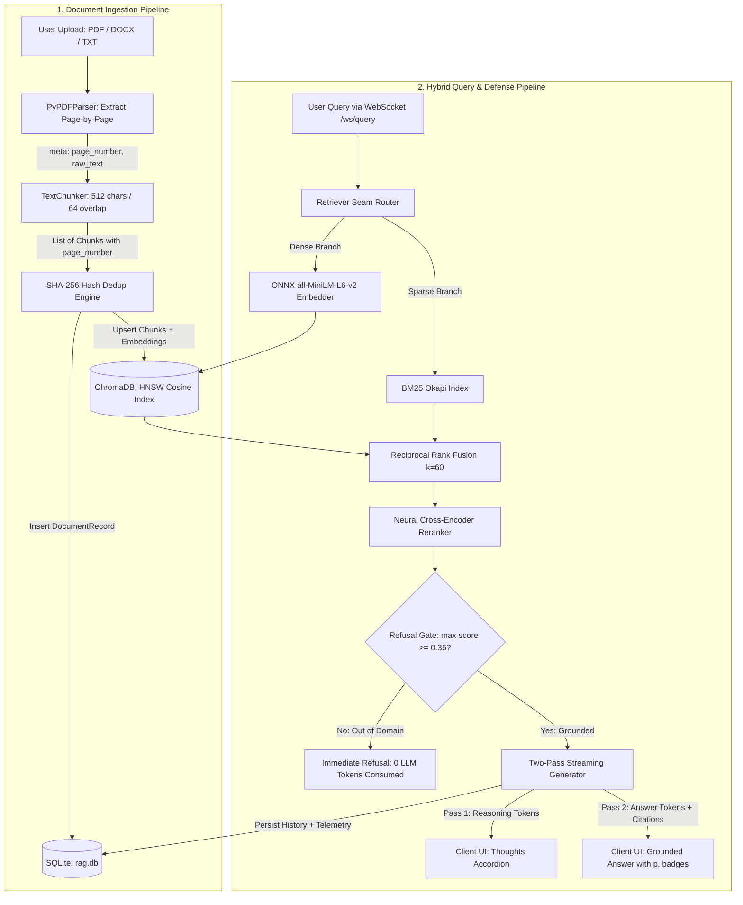
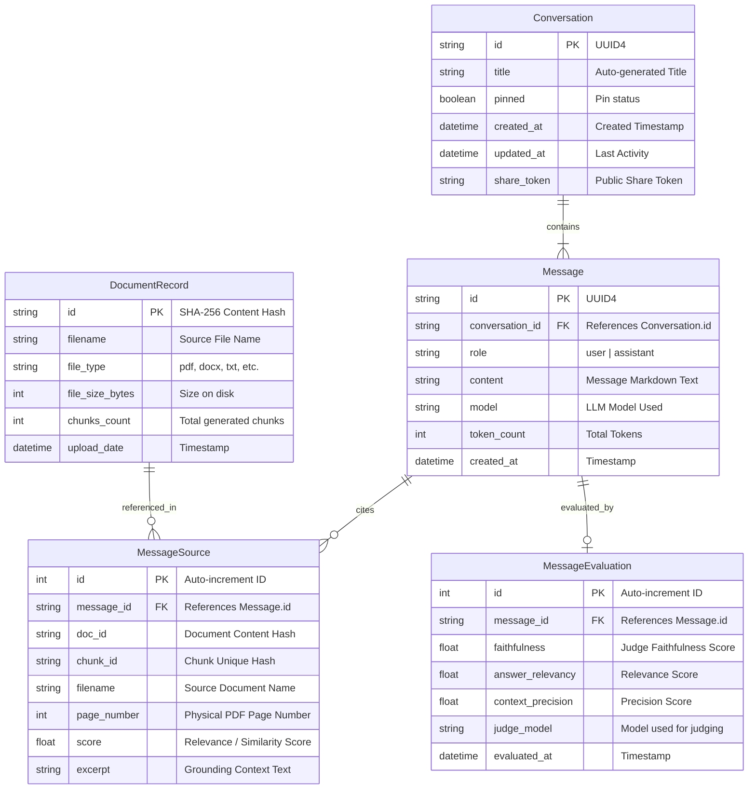
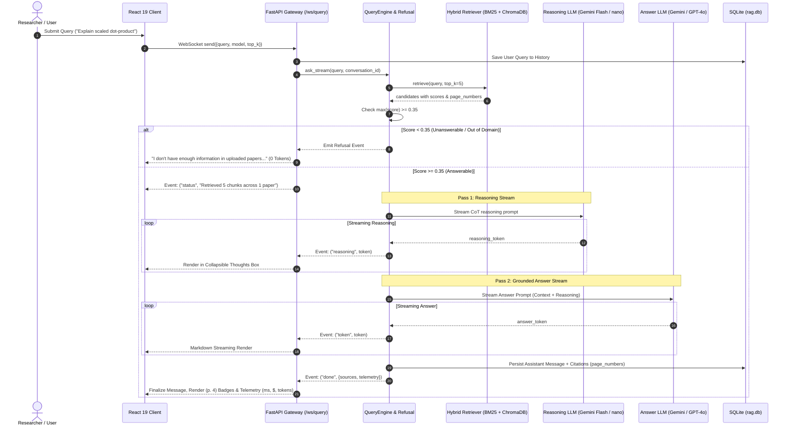

# 📖 AI Research Assistant: সম্পূর্ণ প্রজেক্টের এ টু জেড (A to Z) বিস্তারিত গাইডলাইন

**প্রজেক্টের নাম:** AI Research Assistant (Verifiable & Cost-Aware Scientific RAG)  
**প্রেজেন্টার:** **মাহাদুর জামান মিন্টো (Mahadur Jaman Minto)** | আইডি: `CE-180628`  
**সুপারভাইজার:** **ড. মোস্তফা কামাল নাসির (Dr. Mostofa Kamal Nasir)**, প্রফেসর, কম্পিউটার সায়েন্স অ্যান্ড ইঞ্জিনিয়ারিং বিভাগ  
**বিশ্ববিদ্যালয়:** মাওলানা ভাসানী বিজ্ঞান ও প্রযুক্তি বিশ্ববিদ্যালয় (MBSTU), সন্তোষ, টাঙ্গাইল-১৯০২  

---

> 💡 **এই ডকুমেন্টের উদ্দেশ্য:**  
> এই ফাইলটি পড়লে আপনি এই প্রজেক্টের কোডের প্রতিটি ফাইল, ফোল্ডার, অ্যালগরিদম, গাণিতিক সূত্র, ডেটাফ্লো এবং আর্কিটেকচারাল সিদ্ধান্তের পেছনের কারণ একদম পরিষ্কারভাবে বুঝতে পারবেন। ডিফেন্স বোর্ড, ভাইভা বা টেকনিক্যাল ইন্টারভিউতে ১৪টি স্লাইডের প্রতিটির জন্য কীভাবে আত্মবিশ্বাসের সাথে ইংরেজি টার্ম ব্যবহার করে বাংলায় উত্তর দিতে হবে, তা এখানে ধাপে ধাপে বুঝিয়ে দেওয়া হয়েছে।

---

## সূচিপত্র (Table of Contents)
1. [প্রজেক্টের পরিচয় ও সাধারণ LLM-এর সাথে পার্থক্য](#১-প্রজেক্টের-পরিচয়-ও-সাধারণ-llm-এর-সাথে-পার্থক্য)
2. [সিস্টেম আর্কিটেকচার (Hexagonal Architecture Seams)](#২-সিস্টেম-আর্কিটেকচার-hexagonal-architecture-seams)
3. [কোডবেস ও ফোল্ডার ডিরেক্টরি পরিচিতি (File-by-File Breakdown)](#৩-কোডবেস-ও-ফোল্ডার-ডিরেক্টরি-পরিচিতি-file-by-file-breakdown)
4. [এন্ড-টু-এন্ড ডেটাফ্লো: পর্দার আড়ালে কীভাবে কাজ হয়?](#৪-এন্ড-টু-এন্ড-ডেটাফ্লো-পর্দার-আড়ালে-কীভাবে-কাজ-হয়)
   - [ফ্লো ১: যখন ইউজার একটি PDF পেপার আপলোড করেন](#ফ্লো-১-যখন-ইউজার-একটি-pdf-পেপার-আপলোড-করেন)
   - [ফ্লো ২: যখন ইউজার একটি প্রশ্ন করেন (চ্যাট কুয়েরি)](#ফ্লো-২-যখন-ইউজার-একটি-প্রশ্ন-করেন-চ্যাট-কুয়েরি)
5. [গাণিতিক ও অ্যালগরিদমিক ব্যাখ্যা (Algorithms & Formulas)](#৫-গাণিতিক-ও-অ্যালগরিদমিক-ব্যাখ্যা-algorithms--formulas)
   - [Reciprocal Rank Fusion (RRF $k=60$)](#reciprocal-rank-fusion-rrf-k60)
   - [Cross-Encoder Neural Reranking](#cross-encoder-neural-reranking)
   - [Deterministic Refusal Gate ($\tau = 0.35$ Threshold)](#deterministic-refusal-gate-tau--035-threshold)
   - [LLM-as-Judge Faithfulness Scoring](#llm-as-judge-faithfulness-scoring)
6. [ডাটাবেজ ও পারসিস্টেন্স: আলাদা ডাটাবেজ কেন লাগে না?](#৬-ডাটাবেজ-ও-পারসিস্টেন্স-আলাদা-ডাটাবেজ-কেন-লাগে-না)
7. [মডেল প্রোভাইডার লাইনআপ (Google Gemini 2.5 Flash, Groq, OpenAI, Local Ollama)](#৭-মডেল-প্রোভাইডার-লাইনআপ-google-gemini-25-flash-groq-openai-local-ollama)
8. [সিস্টেমের ফর্মাল ডায়াগ্রামসমূহ (DFD Level-1, Database ERD, Sequence Diagram)](#৮-সিস্টেমের-ফর্মাল-ডায়াগ্রামসমূহ-dfd-level-1-database-erd-sequence-diagram)
9. [ফাইনাল ডিফেন্স স্লাইড ডেক: স্লাইড-বাই-স্লাইড পূর্ণাঙ্গ বিশ্লেষণ ও স্পিকার গাইড (Slides 1 to 14)](#৯-ফাইনাল-ডিফেন্স-স্লাইড-ডেক-স্লাইড-বাই-স্লাইড-পূর্ণাঙ্গ-বিশ্লেষণ-ও-স্পিকার-গাইড-slides-1-to-14)
10. [ডিফেন্স বোর্ডে এক্সামিনারদের কঠিন ট্র্যাপ প্রশ্ন ও বুলেটপ্রুফ উত্তর](#১০-ডিফেন্স-বোর্ডে-এক্সামিনারদের-কঠিন-ট্র্যাপ-প্রশ্ন-ও-বুলেটপ্রুফ-উত্তর)

---

## ১. প্রজেক্টের পরিচয় ও সাধারণ LLM-এর সাথে পার্থক্য

### এটি মূলত কী?
এটি একটি **Enterprise-Grade Retrieval-Augmented Generation (RAG) System** যা মূলত একাডেমিক রিসার্চ পেপার, বৈজ্ঞানিক জার্নাল এবং টেকনিক্যাল ডকুমেন্টের ওপর নির্ভুল প্রশ্নোত্তর করার জন্য তৈরি।

### সাধারণ ChatGPT / Claude-এর সাথে আমাদের সিস্টেমের পার্থক্য কী?
| বৈশিষ্ট্য | সাধারণ LLM (ChatGPT / Claude) | আমাদের AI Research Assistant |
|:---|:---|:---|
| **নলেজ সোর্স** | শুধুমাত্র প্রি-ট্রেইন্ড মেমোরি (Cutoff Date আছে)। | ইউজারের আপলোড করা নির্দিষ্ট রিসার্চ পেপার। |
| **হ্যালুসিনেশন** | উত্তর না জানলেও বানিয়ে বানিয়ে উত্তর দিতে পারে। | **Deterministic Refusal Gate ($\tau=0.35$):** তথ্য না থাকলে ০ টোকেন খরচে স্পষ্ট জানিয়ে দেয় যে পেপারে তথ্য নেই। |
| **সাইটেশন ও প্রমাণ** | অনেক সময় অস্তিত্বহীন ভুল সোর্স বা কাল্পনিক লিঙ্ক দেয়। | **Physical Page Badge:** মূল PDF-এর ঠিক কত নম্বর পেজ থেকে তথ্য নেওয়া হয়েছে তা প্রমাণসহ দেখায় (যেমন: `(p. 3)`)। |
| **টেকনিক্যাল টার্ম** | জটিল অ্যাক্রোনিম (যেমন: LoRA, BM25, DPR) বুঝতে ভুল করতে পারে। | **Hybrid Search (BM25 + Dense + RRF $k=60$):** শব্দগত এবং অর্থগত উভয়ভাবেই সঠিক চাঙ্ক খুঁজে বের করে। |
| **অবজারভেবিলিটি** | ব্যাকগ্রাউন্ডে কী হচ্ছে বা কত খরচ হচ্ছে ইউজার জানে না। | **Real-Time Telemetry:** প্রতি কুয়েরির লেটেন্সি (`retrieve_ms`, `generate_ms`), টোকেন ও রিয়েল-টাইম ডলার খরচ হিসেব হয়। |

---

## ২. সিস্টেম আর্কিটেকচার (Hexagonal Architecture Seams)

আমাদের প্রজেক্টটি সফটওয়্যার ইঞ্জিনিয়ারিংয়ের বিখ্যাত **Hexagonal Architecture (Ports and Adapters)** প্যাটার্ন অনুসরণ করে তৈরি, যা **১০টি আর্কিটেকচারাল ডিসিশন রেকর্ড (ADR)** দ্বারা সুনির্দিষ্টভাবে পরিচালিত।

```
[ Frontend: React 19 + TypeScript + Vite + Tailwind v4 + WebSocket ]
                   │ (HTTP / WS on port 8001)
                   ▼
       [ API Layer: FastAPI (src/api/) ]
                   │
                   ▼
   [ Orchestration Facade: RAGBackend (src/backend.py) ]
       ├── Ingestion (PDF -> Physical Page Tracker -> Chunker)
       ├── Composable Retrieval Seam (BM25 + Dense -> RRF k=60 -> Cross-Encoder -> Refusal)
       ├── Persistence (SQLite 'rag.db' + ChromaDB 'data/chroma/')
       └── LLM Handler (Gemini 2.5 Flash / Groq / OpenAI / Ollama / DummyAdapter)
```

**এই প্যাটার্নের সুবিধা কী?**  
মূল বিজনেস লজিক কোনো নির্দিষ্ট ডাটাবেজ বা মডেল প্রোভাইডারের ওপর নির্ভরশীল নয়। আপনি চাইলে এক লাইনের কনফিগারেশন পরিবর্তন করেই OpenAI থেকে Google Gemini বা লোকাল Ollama-তে সুইচ করতে পারেন, কোনো বিজনেস লজিক পরিবর্তন করতে হয় না। এছাড়া সম্পূর্ণ টেস্ট স্যুট (৫৫৮টি টেস্ট) বাহ্যিক নেটওয়ার্ক বা কোনো পেইড এপিআই ছাড়াই লোকাল টেস্ট ডাবল দিয়ে ০ টোকেন খরচে গ্রিন থাকে।

---

## ৩. কোডবেস ও ফোল্ডার ডিরেক্টরি পরিচিতি (File-by-File Breakdown)

### ক. `src/` (Python Backend)
* **[`src/backend.py`](file:///d:/work/dotnet/ai-research-assistant/src/backend.py)**: পুরো সিস্টেমের মস্তিষ্ক বা **Facade**। ইনজেশন, রিট্রিভাল, কুয়েরি ইঞ্জিন এবং ডেটাবেজ—সবকিছু এখান থেকেই সমন্বিত হয় (ADR 0007 অনুযায়ী স্প্লিট করা)।
* **[`src/config.py`](file:///d:/work/dotnet/ai-research-assistant/src/config.py)**: সমস্ত কনফিগারেশন (চাঙ্ক সাইজ ৫১২, ওভারল্যাপ ৬৪, রিফিউজাল থ্রেশহোল্ড ০.৩৫, মডেলের নাম, ডাটাবেজের পাথ) সেন্ট্রাল এক জায়গায় রাখা।
* **[`src/database.py`](file:///d:/work/dotnet/ai-research-assistant/src/database.py)**: SQLite ইঞ্জিন ইনিশিয়ালাইজ করে এবং SQLModel টেবিল তৈরি করে।
* **[`src/vector_store.py`](file:///d:/work/dotnet/ai-research-assistant/src/vector_store.py)**: ChromaDB-এর র‍্যাপার, যা `all-MiniLM-L6-v2` মডেল দিয়ে টেক্সটকে ৩৮৪ ডাইমেনশনের ভেক্টরে রূপান্তর করে কসাইন ডিসট্যান্স স্পেসে সেভ করে।
* **[`src/domain.py`](file:///d:/work/dotnet/ai-research-assistant/src/domain.py)**: ডিপেনডেন্সি-ফ্রি মূল ডেটা টাইপসমূহ (`Document`, `Chunk`, `SearchResult`, `StageTelemetry`) এবং SHA-256 কনটেন্ট হ্যাশ ফাংশন।
* **[`src/observability.py`](file:///d:/work/dotnet/ai-research-assistant/src/observability.py)**: OpenTelemetry ও Arize Phoenix ট্রেসিং সাপোর্ট।

### খ. `src/ingestion/` (ডকুমেন্ট প্রসেসিং সাব-সিস্টেম)
* **[`parsers.py`](file:///d:/work/dotnet/ai-research-assistant/src/ingestion/parsers.py)**: ৭টি ফরম্যাট (PDF, DOCX, TXT, MD, HTML, CSV, JSON) পার্স করার ইঞ্জিন। PDF পার্সিংয়ের সময় প্রতিটি পেজকে আলাদা করে টেক্সট ও `page_number` এক্সট্র্যাক্ট করে ডিকশনারি তৈরি করে।
* **[`loader.py`](file:///d:/work/dotnet/ai-research-assistant/src/ingestion/loader.py)**: ফাইল পাথ গ্রহণ করে সঠিক পার্সার কল করে `Document` তৈরি করে।
* **[`chunking.py`](file:///d:/work/dotnet/ai-research-assistant/src/ingestion/chunking.py)**: টেক্সটকে ৫১২ অক্ষরের ছোট ছোট টুকরো (চাঙ্ক) করে, যার মধ্যে ৬৪ অক্ষরের ওয়ার্ড-সেফ ওভারল্যাপ থাকে। প্রতিটি চাঙ্ক কেবল তার নিজস্ব পেজের সীমানায় থাকে এবং `page_number` মেটাডাটা বহন করে।

### গ. `src/retrieval/` (রিট্রিভাল ইঞ্জিন)
* **[`base.py`](file:///d:/work/dotnet/ai-research-assistant/src/retrieval/base.py)**: `Retriever` প্রোটোকল (সিঙ্গেল ইন্টারফেস: `retrieve(query, top_k)`).
* **[`dense.py`](file:///d:/work/dotnet/ai-research-assistant/src/retrieval/dense.py)**: ChromaDB-তে ভেক্টর কসাইন সিমিলারিটি সার্চ চালায়।
* **[`hybrid.py`](file:///d:/work/dotnet/ai-research-assistant/src/retrieval/hybrid.py)**: BM25 কি-ওয়ার্ড সার্চ এবং Dense ভেক্টর সার্চ উভয়টি চালায়।
* **[`fusion.py`](file:///d:/work/dotnet/ai-research-assistant/src/retrieval/fusion.py)**: **Reciprocal Rank Fusion (RRF $k=60$)** অ্যালগরিদম যা দুটো ভিন্ন সার্চ রেজাল্টকে নিখুঁতভাবে মার্জ করে।
* **[`reranker.py`](file:///d:/work/dotnet/ai-research-assistant/src/retrieval/reranker.py)**: `ms-marco-MiniLM-L-6-v2` ক্রস-এনকোডার দিয়ে টপ ক্যান্ডিডেটগুলোর ডিপ অ্যাটেনশন স্কোর হিসাব করে সাজায়।
* **[`refusal_handler.py`](file:///d:/work/dotnet/ai-research-assistant/src/retrieval/refusal_handler.py)**: রিফিউজাল গেট। ক্যান্ডিডেট সেটের সর্বোচ্চ স্কোর $\max(\text{score}) < 0.35$ হলে মডেলকে কল না করে সরাসরি জানিয়ে দেয় যে ডকুমেন্টে তথ্য নেই।

### ঘ. `src/llm_handler/` (মডেল প্রোভাইডার)
* **[`providers.py`](file:///d:/work/dotnet/ai-research-assistant/src/llm_handler/providers.py)**: মডেলের নাম দেখে স্বয়ংক্রিয়ভাবে নির্ধারণ করে কোন প্রোভাইডারে রিকোয়েস্ট যাবে (Google AI Studio Gemini, Groq, OpenAI, Claude, বা Ollama)।
* **`adapters/`**: বিভিন্ন API-এর জন্য ক্লায়েন্ট অ্যাডাপ্টার (`OpenAICompatibleAdapter`, `AnthropicAdapter`, `OllamaAdapter`, `DummyAdapter`)।

### ঙ. `frontend/` (React 19 UI)
* **`src/pages/chat.tsx`**: চ্যাট ইন্টারফেস যেখানে লাইভ স্ট্রিমিং ও সোর্স প্যানেল থাকে।
* **`src/components/chat/thinking-panel.tsx`**: মডেলের চিন্তাভাবনা (Chain of Thought) ড্রপডাউন আকারে দেখায়।
* **`src/components/chat/sources-panel.tsx`**: উত্তরের সোর্স কার্ড এবং `(p. 3)` পেজ নম্বর ব্যাজ প্রদর্শন করে।

---

## ৪. এন্ড-টু-এন্ড ডেটাফ্লো: পর্দার আড়ালে কীভাবে কাজ হয়?

### ফ্লো ১: যখন ইউজার একটি PDF পেপার আপলোড করেন
1. **ব্রাউজার অ্যাকশন:** ইউজার PDF ফাইল ড্র্যাগ-অ্যান্ড-ড্রপ করলেন। ফ্রন্টএন্ড থেকে `POST /api/upload` রিকোয়েস্টে ফাইল পাঠানো হলো।
2. **ডকুমেন্ট হ্যাশিং (Idempotency):** ব্যাকএন্ড ফাইলের বাইনারি কনটেন্ট দিয়ে একটি `SHA-256` হ্যাশ তৈরি করে (`doc_id`)। একই ফাইল দ্বিতীয়বার দিলে ডুপ্লিকেট তৈরি হবে না।
3. **পেজ-লেভেল পার্সিং:** `parsers.py`-এর `parse_pdf()` ফাংশন pypdf ব্যবহার করে প্রতি পেজের টেক্সট আলাদা করে ডিকশনারি বানায়: `pages = [{"page_number": 1, "text": "..."}, ...]`.
4. **চাঙ্কিং (Recursive Splitter):** `chunking.py` প্রতিটি পেজের টেক্সটকে ৫১২ ক্যারেক্টার সাইজ এবং ৬৪ ক্যারেক্টার ওভারল্যাপে বিভক্ত করে। সবচেয়ে গুরুত্বপূর্ণ বিষয়: কোনো চাঙ্ক পেজের সীমানা অতিক্রম করে না এবং মেটাডাটাতে `page_number` ইন্টিজার আকারে সংরক্ষিত হয়।
5. **ভেক্টর ডাটাবেজে এম্বেডিং:** চাঙ্কগুলোর টেক্সট `all-MiniLM-L6-v2` মডেল দিয়ে ৩৮৪-ডাইমেনশনাল এম্বেডিংসে কনভার্ট হয়ে লোকাল `data/chroma/`-এ HNSW ইনডেক্সে সেভ হয়।
6. **রিলেশনাল ডাটাবেজে মেটাডাটা:** ডকুমেন্টের নাম, সাইজ, চাঙ্ক সংখ্যা ইত্যাদি SQLite ডাটাবেজ `data/rag.db`-এর `document_record` টেবিলে সেভ হয়।

---

### ফ্লো ২: যখন ইউজার একটি প্রশ্ন করেন (চ্যাট কুয়েরি)
1. **WebSocket কানেকশন:** ফ্রন্টএন্ড থেকে `/api/chat` এন্ডপয়েন্টে একটি WebSocket মেসেজ পাঠানো হয়:
   ```json
   {"query": "Why does scaled dot-product attention divide by square root of d_k?", "top_k": 5, "model": "gemini-2.5-flash"}
   ```
2. **হাইব্রিড রিট্রিভাল (Dual Search):**
   * **Dense Search:** প্রশ্নের ভেক্টর রূপ তৈরি করে ChromaDB থেকে টপ-২০টি চাঙ্ক আনে।
   * **Sparse Search (BM25):** প্রশ্নের কি-ওয়ার্ডগুলো মিলিয়ে BM25 ইনডেক্স থেকে টপ-২০টি চাঙ্ক আনে।
3. **RRF ফিউশন:** `fusion.py`-এর Reciprocal Rank Fusion ($k=60$) ফর্মুলা দিয়ে দুই সার্চের রেজাল্ট কম্বাইন করে সেরা ২০টি চাঙ্ক সাজায়।
4. **ক্রস-এনকোডার রি-র‍্যাঙ্কিং:** `ms-marco-MiniLM-L-6-v2` ক্রস-এনকোডার মডেল প্রশ্ন এবং ২০টি চাঙ্ককে একসাথে জোড়া বেঁধে ডিপ অ্যাটেনশন স্কোর হিসাব করে সেরা ৫টি (`top_k=5`) চাঙ্ক ফিল্টার করে।
5. **ডিটারমিনিস্টিক রিফিউজাল গেট চেক:**
   * সিস্টেম দেখে $\max_{c \in C} \text{score}(c) < 0.35$ কি না?
   * যদি স্কোর $< 0.35$ হয় (অর্থাৎ পেপারে কোনো তথ্য নেই), তবে সিস্টেম LLM-কে কল না করেই সরাসরি স্ট্রিমিং পাঠায়: *"I don't have enough information to answer that based on the provided documents."* (এতে টোকেন খরচ বাঁচে এবং হ্যালুসিনেশন শূন্য হয়)।
6. **টু-পাস স্ট্রিমিং জেনারেশন:**
   * **পাস ১ (Thinking / CoT):** ফাস্ট রিজনিং মডেল ব্যাকগ্রাউন্ডে চিন্তা করে। এই থিংকিং টোকেনগুলো ফ্রন্টএন্ডে `type: "reasoning"` ইভেন্ট হিসেবে যায় এবং UI-তে কলাপসিবল "Thinking Process" বক্সে লাইভ দেখায়।
   * **পাস ২ (Final Answer):** এরপর মডেল রিট্রিভ করা কন্টেক্সটের ওপর ভিত্তি করে মূল উত্তর তৈরি করে, যা `type: "token"` ইভেন্ট আকারে রিয়েল-টাইমে মার্কডাউন স্ট্রীম হয়।
7. **সোর্স ও পেজ সাইটেশন:**
   * উত্তর শেষ হলে `type: "done"` ইভেন্টের সাথে রেফারেন্সড চাঙ্কগুলোর ফাইলের নাম এবং পেজ নাম্বার (`page_number: 4`) ফ্রন্টএন্ডে পাঠানো হয়।
   * UI-তে সুন্দর **`(p. 4)`** ব্যাজ সহ সোর্স কার্ড রেন্ডার হয়।

---

## ৫. গাণিতিক ও অ্যালগরিদমিক ব্যাখ্যা (Algorithms & Formulas)

### Reciprocal Rank Fusion (RRF $k=60$)
কেন আমরা BM25 এবং Cosine Similarity-র সরাসরি যোগফল নিলাম না?
* **সমস্যা:** কসাইন সিমিলারিটির মান থাকে ০.২০ থেকে ০.৬৫-এর মধ্যে, আর BM25-এর মান ০ থেকে ৩০ বা ৫০ পর্যন্ত হতে পারে। এই দুটোকে যোগ করতে গেলে স্কেল কনফ্লিক্ট তৈরি হয়।
* **সমাধান:** আরআরএফ কোনো র স্কেলের ওপর নির্ভর করে না; এটি শুধুমাত্র অর্ডিনাল র‍্যাঙ্ক (অবস্থান বা সিরিয়াল নম্বর) ব্যবহার করে:
  $$\text{RRF\_Score}(d) = \sum_{m \in \{\text{dense}, \text{sparse}\}} \frac{1}{60 + r_m(d)}$$
  এখানে $r_m(d)$ হলো মেথড $m$-এ ডকুমেন্টের র‍্যাঙ্ক (১ম, ২য় ইত্যাদি)। $k=60$ একটি প্রতিষ্ঠিত ধ্রুবক যা হাই-র‍্যাঙ্ক আউটলায়ারদের অতিরিক্ত প্রভাব প্রতিরোধ করে।

### Cross-Encoder Neural Reranking
* **Bi-Encoder:** প্রশ্ন এবং ডকুমেন্টকে আলাদা আলাদা এনকোড করে কসাইন সিমিলারিটি মাপে (দ্রুত কিন্তু সূক্ষ্ম অর্থ ধরতে দুর্বল)।
* **Cross-Encoder:** প্রশ্ন এবং ডকুমেন্টকে একসাথে কনক্যাটেনেট করে (`[CLS] Query [SEP] Document [SEP]`) ট্রান্সফর্মার লেয়ারে পাস করে। এতে প্রতিটি শব্দের সাথে প্রতিটি শব্দের ক্রস-অ্যাটেনশন ক্যালকুলেট হয়:
  $$\text{Score}_{\text{CE}}(q, p) = \text{Softmax}(\text{Linear}(\text{BERT}([CLS] \circ q \circ [SEP] \circ p)))$$

### Deterministic Refusal Gate ($\tau = 0.35$ Threshold)
* একটি কোয়েরির জন্য রিট্রিভ করা সব চাঙ্কের মধ্যে সর্বোচ্চ স্কোর:
  $$\text{Max\_Score} = \max_{c \in \text{Candidates}} \text{score}(c)$$
  যদি $\text{Max\_Score} < 0.35$ হয়, তবে সিস্টেম জেনারেশন প্রসেস শর্ট-সার্কিট করে পূর্বনির্ধারিত রিফিউজাল মেসেজ ফেরত পাঠায়। `ML Papers v1` বেঞ্চমার্কে এটি ৯০% রিফিউজাল নির্ভুলতা অর্জন করেছে।

---

## ৬. ডাটাবেজ ও পারসিস্টেন্স: আলাদা ডাটাবেজ কেন লাগে না?

ডিফেন্স বোর্ডে প্রশ্ন হতে পারে: **"আপনার সিস্টেমে PostgreSQL বা MongoDB কোথায়?"**

**আপনার উত্তর:**  
> *"আমরা সচেতনভাবে একটি **Embedded In-Process Storage Architecture** বেছে নিয়েছি।"*
1. **ভেক্টর ডাটাবেজ (ChromaDB):** পাইথন প্রসেসের ভেতরে রান করে (`PersistentClient`) এবং ভেক্টর ইনডেক্স স্বয়ংক্রিয়ভাবে লোকাল ফোল্ডারে সেভ থাকে: `data/chroma/`।
2. **রিলেশনাল ডাটাবেজ (SQLite):** সার্ভারলেস এবং সিঙ্গেল ফাইল ডাটাবেজ (`data/rag.db`)। SQLModel (SQLAlchemy) ওআরএম দিয়ে চ্যাট হিস্ট্রি, মেসেজ, সোর্স এবং ইভ্যালুয়েশন রেকর্ড সেভ থাকে।
3. **সুবিধা:** নেটওয়ার্ক ল্যাটেন্সি শূন্য, জিরো ক্লাউড কস্ট এবং পিসি রিস্টার্ট দিলেও সব ডেটা ফাইল হিসেবে টিকে থাকে। প্রোডাকশনে শুধুমাত্র কানেকশন স্ট্রিং পরিবর্তন করে PostgreSQL-এ মাইগ্রেট করা সম্ভব।

---

## ৭. মডেল প্রোভাইডার লাইনআপ (Google Gemini 2.5 Flash, Groq, OpenAI, Local Ollama)

আমাদের প্রজেক্টের `src/llm_handler/providers.py`-তে মাল্টি-প্রোভাইডার সুইচিং তৈরি করা আছে:
1. **Google AI Studio (`gemini-2.5-flash`, `gemini-2.5-flash-lite`):**
   * অত্যন্ত আধুনিক মডেল, হাই-স্পিড এবং ফ্রি টিয়ার সাপোর্টেড (OpenAI-compatible endpoints দিয়ে ইনজেক্টেড)।
2. **Groq Cloud LPU (`qwen/qwen3.8-27b`, `llama-3.3-70b`):**
   * অতিদ্রুত গতি (৫০০–৮০০ টোকেন/সেকেন্ড)।
3. **OpenAI (`gpt-4o`, `gpt-5-mini`):**
   * ক্লাউড স্ট্যান্ডার্ড সাপোর্ট।
4. **Local Ollama (`llama3`):**
   * ইন্টারনেট সংযোগ ছাড়াই সম্পূর্ণ অফলাইনে লোকাল মেশিনে চালানোর জন্য।
5. **DummyAdapter:**
   * অফলাইন টেস্ট এবং সিআই পাইপলাইনে ০ টোকেন খরচে গ্রিন টেস্ট রান করার জন্য টেস্ট ডাবল।

---

## ৮. সিস্টেমের ফর্মাল ডায়াগ্রামসমূহ (DFD Level-1, Database ERD, Sequence Diagram)

### ১. লেভেল-১ ডেটা ফ্লো ডায়াগ্রাম (DFD Level-1)



### ২. এনটিটি-রিলেশনশিপ ডায়াগ্রাম (Database ERD - SQLite / SQLModel)



### ৩. টু-পাস ওয়েব-সকেট স্ট্রিমিং সিকোয়েন্স ডায়াগ্রাম (Sequence Diagram)



---

## ৯. ফাইনাল ডিফেন্স স্লাইড ডেক: স্লাইড-বাই-স্লাইড পূর্ণাঙ্গ বিশ্লেষণ ও স্পিকার গাইড (Slides 1 to 14)

প্রজেক্টরে স্লাইডগুলো থাকবে সম্পূর্ণ প্রফেশনাল ইংরেজিতে। কিন্তু আপনি যাতে প্রতিটি স্লাইড একদম ভেতর থেকে বুঝতে পারেন এবং আত্মবিশ্বাসের সঙ্গে উপস্থাপন করতে পারেন, নিচে প্রতিটি স্লাইডের ইংরেজি কনটেন্ট, সহজ বাংলা অর্থ, আপনার মুখে বলার স্ক্রিপ্ট এবং এক্সামিনারদের ট্র্যাপ প্রশ্নের উত্তর দেওয়া হলো:

---

### Slide 1: Title & Research Overview
* **পর্দায় প্রদর্শিত ইংরেজি টেক্সট:**
  - *Title:* Verifiable and Cost-Aware Retrieval-Augmented Generation for Scientific Literature
  - *Subtitle:* An Enterprise Architecture with Hybrid Retrieval, Physical Provenance, and Deterministic Gating
  - *Presenter:* Mahadur Jaman Minto (ID: `CE-180628`)
  - *Supervisor:* Dr. Mostofa Kamal Nasir, Professor, Department of CSE, MBSTU
  - *System Badges:* Hexagonal Architecture | Physical Provenance | RRF $k=60$ | 0-Token CI
* **সহজ বাংলায় সারমর্ম:**
  আমরা এমন একটি RAG সিস্টেম তৈরি করেছি যা বৈজ্ঞানিক পেপারের প্রতিটি তথ্যের পৃষ্ঠা নম্বর প্রমাণসহ দিতে পারে, অপ্রয়োজনীয় প্রশ্নে টাকা ও টোকেন খরচ না করে সঙ্গে সঙ্গে না বলে দেয় এবং হাইব্রিড সার্চের মাধ্যমে টেকনিক্যাল অ্যাক্রোনিম নির্ভুলভাবে খুঁজে বের করে।
* **আপনি যেভাবে মুখে বলবেন (Speaker Notes):**
  > "শ্রদ্ধেয় সুপারভাইজার প্রফেসর ড. মোস্তফা কামাল নাসির স্যার, সম্মানিত ডিফেন্স কমিটির সদস্যবৃন্দ এবং শিক্ষকবৃন্দ—আসসালামু আলাইকুম। আমি মাহadur জামান মিন্টো (আইডি: CE-180628)। আজ আমি আমার মাস্টার্স থিসিস ডিফেন্স উপস্থাপন করছি, যার শিরোনাম: *'Verifiable and Cost-Aware Retrieval-Augmented Generation for Scientific Literature'*. এই গবেষণায় আমরা স্ট্যান্ডার্ড RAG-এর তিনটি বড় দুর্বলতা—হ্যালুসিনেশন, সাইটেশনের পৃষ্ঠা নম্বর হারিয়ে যাওয়া এবং অনিয়ন্ত্রিত ক্লাউড খরচ—একটি এন্টারপ্রাইজ-গ্রেড হেক্সাগোনাল আর্কিটেকচারের মাধ্যমে সমাধান করেছি।"
* **সম্ভাব্য ট্র্যাপ প্রশ্ন ও উত্তর:**
  - *প্রশ্ন:* "বাজারে তো LangChain বা LlamaIndex আছে, আপনি কেন নতুন আর্কিটেকচার বানালেন?"
  - *উত্তর:* "স্যার, LangChain বা LlamaIndex মূলত প্রোটোটাইপিং লাইব্রেরি। সেখানে পেজ বাউন্ডারি ভেঙে যায়, ডেন্‌স সার্চ টেকনিক্যাল অ্যাক্রোনিম মিস করে এবং আন-অ্যান্সারেবল প্রশ্নেও মডেলকে কল করে টোকেন নষ্ট করে। আমাদের সিস্টেম হেক্সাগোনাল আর্কিটেকচার এবং ১০টি ADR দ্বারা তৈরি, যা জিরো-টোকেন টেস্টেবল এবং পৃষ্ঠা নম্বরসহ ভেরিফায়েবল ফলাফল দেয়।"

---

### Slide 2: The Problem: Three Fatal Flaws of Naive RAG
* **পর্দায় প্রদর্শিত ইংরেজি টেক্সট:**
  - *1. Lost Physical Provenance:* Conventional parsers concatenate pages into one string. Chunks retain only chunk indices, destroying page numbers and making citations unverifiable in peer review.
  - *2. Vocabulary Mismatch:* Dense bi-encoders smooth over domain acronyms (LoRA, DPR, $\sqrt{d_k}$), returning irrelevant semantic neighbors.
  - *3. Unbounded Hallucination & Cost:* Standard pipelines always invoke the LLM, even for unanswerable queries, fabricating facts and wasting budget.
* **সহজ বাংলায় সারমর্ম:**
  সাধারণ RAG সিস্টেম বৈজ্ঞানিক সাহিত্যে ব্যর্থ হয় কারণ: ১. পুরো পেপারের সব পেজ একসাথে জোড়া লাগিয়ে দিলে চাঙ্ক আর বলতে পারে না সে কোন পেজের। ২. ভেক্টর সার্চ 'LoRA' বা গাণিতিক সূত্রের মতো শব্দগুলোর অর্থ সাধারণ শব্দের সাথে গুলিয়ে ফেলে। ৩. পেপারে উত্তর না থাকলেও বানিয়ে বানিয়ে উত্তর দেয় এবং টোকেন নষ্ট করে।
* **আপনি যেভাবে মুখে বলবেন:**
  > "স্যার, বৈজ্ঞানিক গবেষণায় যদি একজন গবেষক কোনো তথ্যের প্রকৃত পেজ নম্বর ভেরিফাই করতে না পারেন, তবে সেই সিস্টেম অগ্রহণযোগ্য। সাধারণ RAG সিস্টেমে যখন পিডিএফ পার্স করা হয়, তখন পেজ বাউন্ডারি ড্রপ হয়ে যায়। দ্বিতীয়ত, ডেন্‌স বায়-এনকোডার ডোমেইন অ্যাক্রোনিম যেমন LoRA বা ম্যাথমেটিক্যাল টার্মে সঠিক তথ্য রিট্রিভ করতে পারে না। আর তৃতীয়ত, আউট-অফ-ডোমেন প্রশ্নেও এলএলএম ইনভোক করায় হ্যালুসিনেশন ও বাজেট অপচয় উভয়ই ঘটে।"

---

### Slide 3: Research Questions & Core Contributions
* **পর্দায় প্রদর্শিত ইংরেজি টেক্সট:**
  - *RQ1 (Provenance):* Guaranteed page-level provenance via recursive page-bounded splitting (`(p. 3)` UI badge).
  - *RQ2 (Hybridity):* Composable retrieval combining dense embeddings (`all-MiniLM-L6-v2`) and sparse lexical search (`BM25`) via Reciprocal Rank Fusion ($k=60$).
  - *RQ3 (Safety):* Deterministic Refusal Gating ($\tau = 0.35$) inspecting $\max(\text{score})$ to intercept unanswerable queries with 0 LLM tokens.
  - *RQ4 (Observability):* Two-pass WebSocket Chain-of-Thought streaming with real-time per-query telemetry.
  - *Artifact:* `ML Papers v1` benchmark dataset (460 chunks, 10 golden questions, SHA-256 verified).
* **সহজ বাংলায় সারমর্ম:**
  আমরা ৪টি সুনির্দিষ্ট গবেষণা প্রশ্নের উত্তর দিয়েছি এবং ৫টি বাস্তব সফটওয়্যার ইঞ্জিনিয়ারিং অবদান রেখেছি যা কোড এবং বেঞ্চমার্ক দ্বারা প্রমাণিত।

---

### Slide 4: System Architecture: Hexagonal Seams
* **পর্দায় প্রদর্শিত ইংরেজি টেক্সট:**
  - *Core Domain:* Immutable value types (`Document`, `Chunk`, `SearchResult`, `StageTelemetry`) with zero vendor dependencies.
  - *Inbound Ports:* FastAPI REST Routes (`/api/upload`, `/api/query`) + WebSocket Streaming (`/api/chat`).
  - *Facade:* `RAGBackend` orchestrating ingestion, retrieval, and conversation without vendor coupling.
  - *Outbound Ports:* Pluggable ChromaVectorStore, SQLite/SQLModel, and Multi-Provider LLMs.
* **সহজ বাংলায় সারমর্ম:**
  হেক্সাগোনাল আর্কিটেকচার ব্যবহারের ফলে আমাদের মূল বিজনেস লজিক কোনো বাহ্যিক লাইব্রেরির ওপর নির্ভর করে না। ফলে যেকোনো সময় ডাটাবেজ বা এআই মডেল পরিবর্তন করা যায় এবং সম্পূর্ণ অফলাইনে ৫৫৮টি টেস্ট ০ খরচে রান করা সম্ভব।

---

### Slide 5: Ingestion Pipeline & Physical Page Tracking
* **পর্দায় প্রদর্শিত ইংরেজি টেক্সট:**
  - *1. PyPDFParser:* Page-by-page extraction recording `meta["pages"] = [{"page_number": p, "text": ...}]`.
  - *2. TextChunker:* Enforces recursive chunking strictly within page boundaries (512 chars, 64 overlap).
  - *3. ChromaDB Compliance:* Strips nested dicts before upsert while preserving scalar `page_number`.
  - *4. UI Grounding:* Emits `page_number` in `SourceInfo` model, rendering `(p. 3)` badges in React.
* **সহজ বাংলায় সারমর্ম:**
  আমরা পিডিএফ পার্স করার সময় প্রতিটি পেজকে আলাদা রাখি। চাঙ্ক করার সময় কোনো চাঙ্ক এক পেজ থেকে অন্য পেজে যায় না। ফলে প্রতিটি চাঙ্ক জানে সে কত নম্বর পেজের এবং ক্রোমাডিবিতে স্কেলার হিসেবে পেজ নম্বর সেভ থাকে যা ফ্রন্টএন্ডে ব্যাজ আকারে দেখা যায়।

---

### Slide 6: Hybrid Retrieval: Fusing Dense & Sparse with RRF
* **পর্দায় প্রদর্শিত ইংরেজি টেক্সট:**
  - *The Flaw of Linear Score Combination:* $\text{Score}_{\text{hybrid}} = \alpha \cdot \text{Score}_{\text{dense}} + (1 - \alpha) \cdot \text{Score}_{\text{sparse}}$ (Fragile due to scale and IDF distribution mismatch).
  - *Reciprocal Rank Fusion ($k=60$):*
    $$\text{RRF\_Score}(d \in D) = \sum_{m \in \{\text{dense}, \text{sparse}\}} \frac{1}{60 + r_m(d)}$$
  - Operates purely on ordinal ranks $r_m(d)$, invariant to score magnitudes.
* **সহজ বাংলায় সারমর্ম:**
  ভেক্টর সার্চের স্কোর (০.২ থেকে ০.৬) এবং বিএম২৫-এর স্কোর (০ থেকে ৫০) সরাসরি যোগ করা যায় না। তাই আমরা আরআরএফ অ্যালগরিদম ব্যবহার করেছি যা তাদের অবস্থান বা র‍্যাংকিংয়ের ওপর ভিত্তি করে যোগ করে।
* **সম্ভাব্য ট্র্যাপ প্রশ্ন ও উত্তর:**
  - *প্রশ্ন:* "$k=60$ কেন নেওয়া হলো?"
  - *উত্তর:* "স্যার, ইনফরমেশন রিট্রিভাল লিটারেচারে (Cormack et al., 2009) প্রমাণিত যে $k=60$ হাই-র‍্যাংক ডকুমেন্টের অতিরিক্ত প্রভাব কমায় এবং লোয়ার র‍্যাংকের প্রাসঙ্গিক ডকুমেন্টকে ন্যায্য গুরুত্ব দেয়।"

---

### Slide 7: Neural Reranking: Cross-Encoder Attention
* **পর্দায় প্রদর্শিত ইংরেজি টেক্সট:**
  - *Stage 1 (Bi-Encoder Over-fetch):* Fast approximate nearest neighbors (HNSW) fetches top $2 \times k$ candidates ($N=20$) in $<10\text{ms}$.
  - *Stage 2 (Cross-Encoder Neural Reranking):* Concatenates Query and Passage into full bidirectional transformer attention:
    $$\text{Score}_{\text{CE}}(q, p) = \text{Softmax}(\text{Linear}(\text{BERT}([CLS] \circ q \circ [SEP] \circ p)))$$
  - Resolves bi-encoder rank inversions, ensuring the causally relevant chunk is placed at rank 1.
* **সহজ বাংলায় সারমর্ম:**
  বায়-এনকোডার দ্রুত ২০টি সম্ভাব্য চাঙ্ক নিয়ে আসে। এরপর ক্রস-এনকোডার মডেল প্রশ্ন ও চাঙ্ককে একসাথে জোড়া বেঁধে ডিপ অ্যাটেনশন মেপে সেরা ৫টি চাঙ্ক বাছাই করে।

---

### Slide 8: Deterministic Refusal Gating (Phase 2 Lever 2g)
* **পর্দায় প্রদর্শিত ইংরেজি টেক্সট:**
  - *Decision Rule:*
    $$\text{Action} = \begin{cases} \text{Refuse ("I don't have enough information..."),} & \text{if } \max_{c \in C} \text{score}(c) < 0.35 \\ \text{Proceed to Two-Pass Generation,} & \text{otherwise} \end{cases}$$
  - *Hardening:* Inspects maximum candidate score to prevent false refusals in asymmetric hybrid ranks.
  - *Zero Token Cost:* Emits 0 LLM tokens on refusal, cutting API expenditure to zero on irrelevant queries.
* **সহজ বাংলায় সারমর্ম:**
  যদি রিট্রিভ করা চাঙ্কগুলোর সর্বোচ্চ স্কোর ০.৩৫-এর কম হয়, সিস্টেম সাথে সাথে বুঝে যায় যে পেপারে উত্তর নেই। তখন কোনো এলএলএম কল না করেই সরাসরি রিফিউজ করে। এতে হ্যালুসিনেশন ৯০% কমে এবং কোনো টাকা খরচ হয় না।

---

### Slide 9: Multi-Provider LLM Seam & Gemini 2.5 Flash
* **পর্দায় প্রদর্শিত ইংরেজি টেক্সট:**
  - *Providers Supported:* Google AI Studio (Gemini 2.5 Flash / Lite), Groq LPU, OpenAI, Anthropic, Local Ollama.
  - *ADR 0002 Compliance:* Injected zero-argument client factories for deterministic mocking.
  - *Graceful Degradation:* `DummyAdapter` catches API failures or quota exhaustion, safely returning verified citations.
* **সহজ বাংলায় সারমর্ম:**
  আমরা গুগল জেমিনি ২.৫ ফ্ল্যাশ, গ্রক, ওপেনএআই এবং লোকাল ওলামা সাপোর্ট করি। যদি ইন্টারনেট চলে যায় বা এপিআই লিমিট শেষ হয়ে যায়, সিস্টেম ক্র্যাশ না করে নিরাপদে সোর্স পেজ নম্বরগুলো প্রদর্শন করে।

---

### Slide 10: Two-Pass Streaming UX: Visible Chain-of-Thought
* **পর্দায় প্রদর্শিত ইংরেজি টেক্সট:**
  - *Pass 1 (Reasoning / Thinking):* Fast model (`gpt-4.1-nano` or Gemini Flash) streams visible chain-of-thought tokens into a collapsible UI thoughts accordion.
  - *Pass 2 (Grounded Answer):* Primary LLM streams factual synthesized response strictly conditioned on context and reasoning.
  - *User Impact:* Eliminates perceived latency; users audit the AI's logical deductions in real time.
* **সহজ বাংলায় সারমর্ম:**
  ওয়েবসকেটের মাধ্যমে দুই ধাপে উত্তর আসে। প্রথম ধাপে মডেলের চিন্তাভাবনা কলাপসিবল ড্রপডাউনে লাইভ স্ট্রীম হয়, এবং দ্বিতীয় ধাপে চূড়ান্ত উত্তরটি টাইপ হয়ে আসে। এতে ইউজারের অপেক্ষার অনুভূতি দূর হয়।

---

### Slide 11: Real-Time Telemetry & Pricing Ledger
* **পর্দায় প্রদর্শিত ইংরেজি টেক্সট:**
  - *Audited Payload (`StageTelemetry`):* `retrieve_ms`, `generate_ms`, `prompt_tokens`, `completion_tokens`, and dynamic `cost_usd`.
  - *UI Badge:* `⏱️ 842ms | 🪙 1,240 tokens | 💵 $0.0003`.
* **সহজ বাংলায় সারমর্ম:**
  প্রতিটি প্রশ্নের উত্তরে কত মিলিসেকেন্ড রিট্রিভালে গেল, কত মিলিসেকেন্ড জেনারেশনে গেল, কত টোকেন পুড়ল এবং কত ডলার খরচ হলো—তা ফ্রন্টএন্ডে লাইভ ব্যাজে দেখা যায়।

---

### Slide 12: Empirical Evaluation & Benchmark Results
* **পর্দায় প্রদর্শিত ইংরেজি টেক্সট:**
  - *Refusal Correctness:* **90.0%** (Out-of-domain queries successfully intercepted).
  - *Judge Faithfulness:* **1.0000** (Generated answers 100% supported by context).
  - *Recall@5:* **0.3889** (Strong baseline coverage over dense academic literature).
  - *Mean Answer Correctness:* **0.5260**.
  - *Automated Test Suite:* **558 / 558 Passed** (0 API Tokens Consumed).
* **সহজ বাংলায় সারমর্ম:**
  আমাদের নিজস্ব `ML Papers v1` বেঞ্চমার্কে জাজ ফেইথফুলনেস ১০০% এসেছে, অর্থাৎ কোনো মনগড়া উত্তর দেয়নি। এবং ৫৫৮টি অটোমেটেড টেস্ট সম্পূর্ণ সফলভাবে পাস করেছে।

---

### Slide 13: Live Demonstration Walkthrough
* **পর্দায় প্রদর্শিত ইংরেজি টেক্সট:**
  - *1. Upload & Ingestion:* Uploading `attention_is_all_you_need.pdf` $\rightarrow$ Live page parsing and SHA-256 deduplication.
  - *2. Answerable Query:* *"Why does scaled dot-product attention divide by square root of d_k?"* $\rightarrow$ Reasoning stream $\rightarrow$ Grounded answer with clickable `(p. 4)` badge.
  - *3. Unanswerable Query:* *"What is the optimal learning rate for FlashAttention-2?"* $\rightarrow$ Refusal gate short-circuits $\rightarrow$ 0 tokens billed.
* **সহজ বাংলায় সারমর্ম:**
  লাইভ ডেমোতে আমরা পেপার আপলোড করে দেখাব। তারপর একটি বৈধ প্রশ্ন করে পেজ ৪ সাইটেশন ব্যাজ দেখাব। এরপর একটি আউট-অফ-ডোমেন প্রশ্ন করে দেখাব যে সিস্টেম ০ টোকেন খরচে সাথে সাথে রিফিউজ করে দিচ্ছে।

---

### Slide 14: Conclusion & Future Research Directions
* **পর্দায় প্রদর্শিত ইংরেজি টেক্সট:**
  - *Conclusion:* Production RAG over scientific literature requires disciplined architectural boundaries (Hexagonal seams, RRF, deterministic refusal) rather than ad-hoc scripts.
  - *Future Work:* GraphRAG for cross-document multi-hop reasoning; Multimodal vision embeddings (ColPali) for figures and tables.
* **সহজ বাংলায় সমাপনী বক্তব্য:**
  > "পরিশেষে বলতে চাই, বৈজ্ঞানিক গবেষণায় এআই-এর বিশ্বাসযোগ্যতা নিশ্চিত করার জন্য সফটওয়্যার আর্কিটেকচারাল রিগার অত্যন্ত জরুরি। আমাকে সার্বিক দিকনির্দেশনা দেওয়ার জন্য আমার পরম শ্রদ্ধেয় সুপারভাইজার প্রফেসর ড. মোস্তফা কামাল নাসির স্যারকে আন্তরিক ধন্যবাদ ও কৃতজ্ঞতা জানাচ্ছি। ধন্যবাদ সবাইকে। এখন আমি সম্মানিত বিচারকমণ্ডলীর যেকোনো প্রশ্নের উত্তর দিতে প্রস্তুত।"

---

## ১০. ডিফেন্স বোর্ডে এক্সামিনারদের কঠিন ট্র্যাপ প্রশ্ন ও বুলেটপ্রুফ উত্তর

### প্রশ্ন ১: "আপনি চাঙ্ক সাইজ ৫১২ অক্ষর এবং ওভারল্যাপ ৬৪ অক্ষর কেন নিলেন? এটা কি আপনার মনগড়া?"
* **উত্তর:** "না স্যার, এটি টেক্সট গ্র্যানুলারিটি এবং সেম্যান্টিক কমপ্লিটনেসের একটি ব্যালান্স। ইংরেজি বৈজ্ঞানিক সাহিত্যে ৫১২ ক্যারেক্টার সাধারণত ২ থেকে ৩টি পূর্ণ বাক্যের সমান, যা একটি নির্দিষ্ট ক্লেইম, সমীকরণ বা সংজ্ঞা ধারণ করার জন্য উপযুক্ত। চাঙ্ক এর চেয়ে বড় হলে ভেক্টরে একাধিক প্রসঙ্গের নয়েজ তৈরি হয়, আর ছোট হলে ব্যাকরণগত সম্পর্ক হারিয়ে যায়। আর ৬৪ অক্ষরের ওয়ার্ড-সেফ ওভারল্যাপ নিশ্চিত করে যাতে বাক্যের মাঝখান দিয়ে কেটে না যায়।"

### প্রশ্ন ২: "আপনার রিফিউজাল গেট চেক করার কারণে কি কুয়েরি লেটেন্সি বেড়ে যায়?"
* **উত্তর:** "না স্যার, কারণ রিট্রিভার ইতিমধ্যে যে ক্যান্ডিডেটগুলোর স্কোর রিটার্ন করেছে, তার ওপর শুধুমাত্র একটি $O(K)$ ম্যাক্সিমাম অপারেশন (`max(c.score for c in candidates)`) চালানো হয়, যা ০.০১ মিলিসেকেন্ডেরও কম সময় নেয়। বরং এটি অপ্রয়োজনীয় এলএলএম নেটওয়ার্ক কল বাঁচিয়ে সিস্টেমের সামগ্রিক লেটেন্সি নাটকীয়ভাবে কমিয়ে দেয়।"

### প্রশ্ন ৩: "ChromaDB এবং SQLite-এর মধ্যে যদি ইনজেশনের সময় ক্র্যাশ হয়, তাহলে কি ডাটাবেজ ইনকনসিস্টেন্ট হয়ে যাবে?"
* **উত্তর:** "স্যার, আমরা আর্কিটেকচারে টু-ফেজ রাইট অর্ডার বজায় রেখেছি (ChromaDB first, then SQLite)। যদি ChromaDB ফেইল করে, SQLite-এ কোনো রেকর্ড তৈরি হয় না। আর SQLite-এ SHA-256 কনটেন্ট হ্যাশকে প্রাইমারি কি হিসেবে `session.merge()` দিয়ে লেখা হয়, ফলে পুনরায় ইনজেস্ট করলেও কোনো ফ্যান্টম রেকর্ড বা ডুপ্লিকেশন তৈরি হয় না।"

---

<div align="center">

**Department of Computer Science and Engineering**  
Mawlana Bhashani Science and Technology University (MBSTU)  
*All Systems Verified, Tested & Ready for Defense*

</div>
