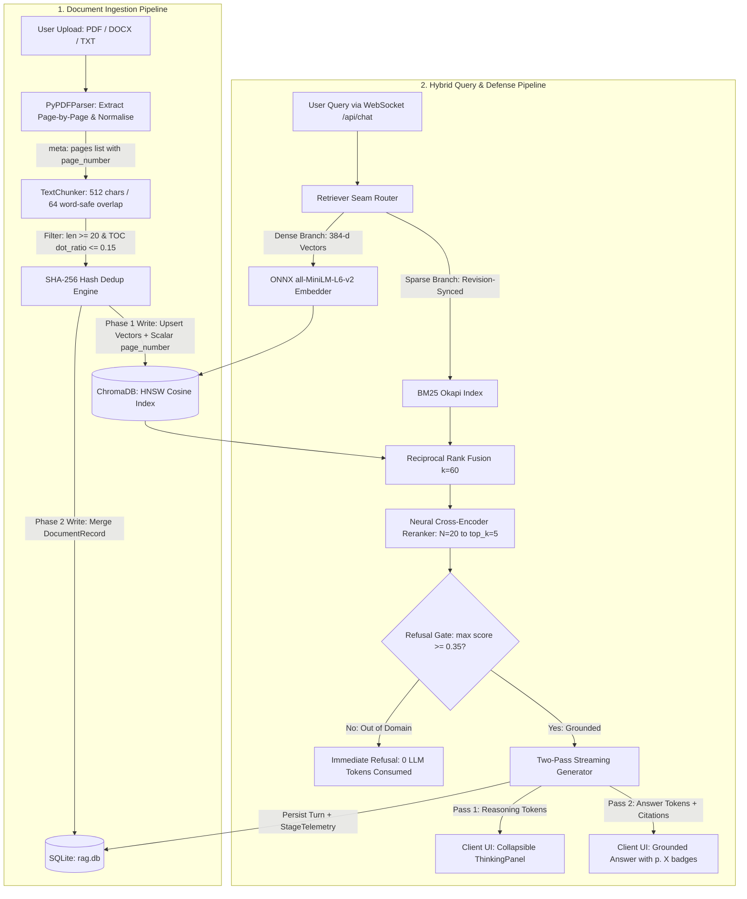
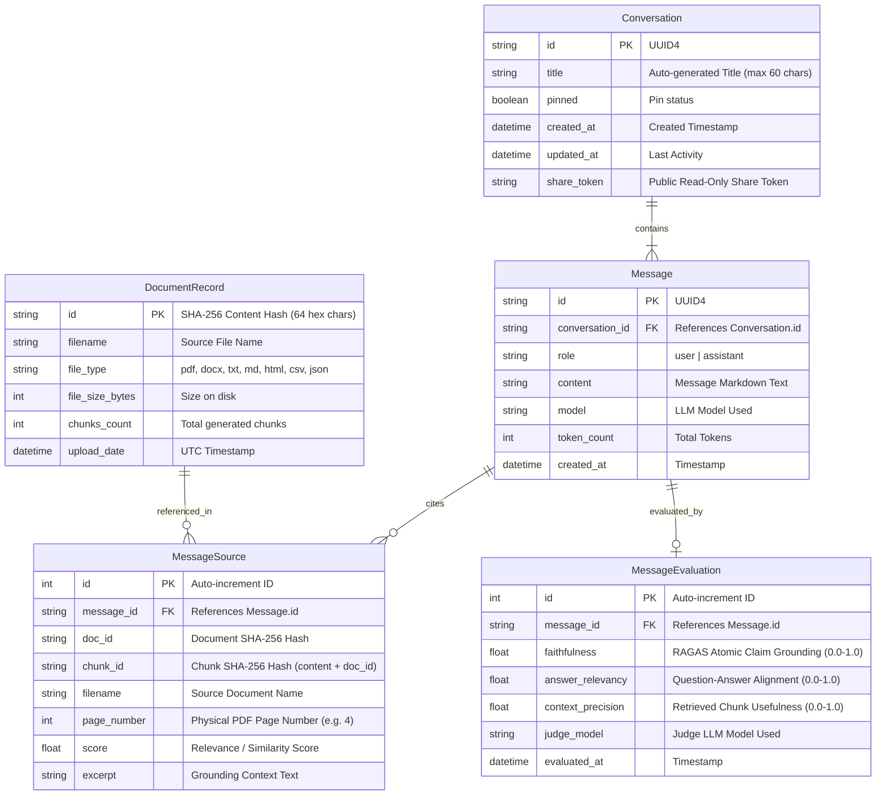
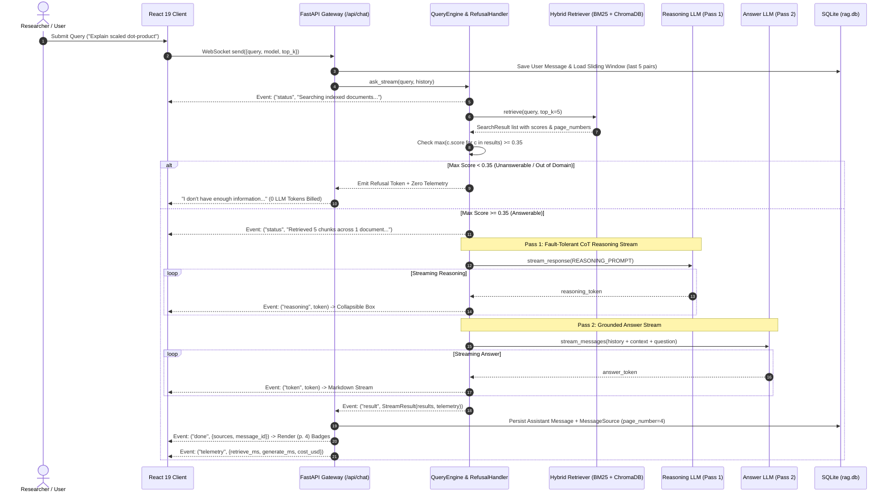

# 📖 AI Research Assistant: সম্পূর্ণ প্রজেক্টের এ টু জেড (A to Z) মাস্টার গাইডলাইন ও প্রি-ডিফেন্স হ্যান্ডবুক

**প্রজেক্টের নাম:** Verifiable and Cost-Aware Retrieval-Augmented Generation for Scientific Literature  
**সাবটাইটেল:** An Enterprise Architecture with Hybrid Retrieval, Physical Provenance, and Deterministic Gating  
**প্রেজেন্টার / ক্যান্ডিডেট:** **মাহাদুর জামান মিন্টো (Mahadur Jaman Minto)** | স্টুডেন্ট আইডি: `CE-180628`  
**সুপারভাইজার:** **প্রফেসর ড. মোস্তফা কামাল নাসির (Dr. Mostofa Kamal Nasir)**, কম্পিউটার সায়েন্স অ্যান্ড ইঞ্জিনিয়ারিং (CSE) বিভাগ  
**ডিগ্রি প্রোগ্রাম:** Master of Engineering (M.Engg.) in Computer Science and Engineering  
**বিশ্ববিদ্যালয়:** মাওলানা ভাসানী বিজ্ঞান ও প্রযুক্তি বিশ্ববিদ্যালয় (MBSTU), সন্তোষ, টাঙ্গাইল-১৯০২  

---

> 💡 **প্রি-ডিফেন্স ও ফাইনাল ডিফেন্সের জন্য বিশেষ নির্দেশিকা:**  
> এই ডকুমেন্টটি আপনার প্রজেক্টের **সম্পূর্ণ টেকনিক্যাল ব্লুপ্রিন্ট**। স্যাররা যদি কোডের যেকোনো ফাইল, যেকোনো গাণিতিক সূত্র, কেন এই প্যারামিটার নিলেন, কেন ওই লাইব্রেরি নেননি, ডেটাবেজে ক্র্যাশ হলে কী হবে, থ্রেড-সেফটি কীভাবে কাজ করে, কিংবা বেঞ্চমার্কের স্ট্যাটিস্টিক্যাল কনফিডেন্স ইন্টারভ্যাল কীভাবে হিসাব করেছেন—এমন যেকোনো গভীর প্রশ্ন করেন, তার ১০০% নির্ভুল, কোড-ভিত্তিক এবং একাডেমিক উত্তর এখানে ধাপে ধাপে সাজিয়ে দেওয়া হয়েছে।

---

## 📑 সূচিপত্র (Table of Contents)
1. [প্রজেক্টের মূল থিম, গবেষণা প্রশ্ন (RQ1–RQ4) ও সাধারণ সিস্টেমের সাথে পার্থক্য](#১-প্রজেক্টের-মূল-থিম-গবেষণা-প্রশ্ন-rq1rq4-ও-সাধারণ-সিস্টেমের-সাথে-পার্থক্য)
2. [সিস্টেম আর্কিটেকচার (Hexagonal Architecture) এবং ১০টি ADR-এর পোস্টমর্টেম](#২-সিস্টেম-আর্কিটেকচার-hexagonal-architecture-এবং-১০টি-adr-এর-পোস্টমর্টেম)
3. [কোডবেস ও প্রতিটি ফাইল-ফোল্ডারের গভীর ব্যবচ্ছেদ (Micro-Level Codebase Breakdown)](#৩-কোডবেস-ও-প্রতিটি-ফাইল-ফোল্ডারের-গভীর-ব্যবচ্ছেদ-micro-level-codebase-breakdown)
4. [এন্ড-টু-এন্ড ডেটাফ্লো: পর্দার আড়ালে মাইক্রো-লেভেলে কীভাবে কাজ হয়?](#৪-এন্ড-টু-এন্ড-ডেটাফ্লো-পর্দার-আড়ালে-মাইক্রো-লেভেলে-কীভাবে-কাজ-হয়)
   - [ফ্লো ১: যখন ইউজার একটি PDF পেপার আপলোড করেন (Ingestion Pipeline)](#ফ্লো-১-যখন-ইউজার-একটি-pdf-পেপার-আপলোড-করেন-ingestion-pipeline)
   - [ফ্লো ২: যখন ইউজার একটি প্রশ্ন করেন (Hybrid Query & Two-Pass Streaming)](#ফ্লো-২-যখন-ইউজার-একটি-প্রশ্ন-করেন-hybrid-query--two-pass-streaming)
5. [গাণিতিক সূত্র, অ্যালগরিদম এবং ইভ্যালুয়েশন মেট্রিক্সের গভীর বিশ্লেষণ (Algorithms & Math Deep Dive)](#৫-গাণিতিক-সূত্র-অ্যালগরিদম-এবং-ইভ্যালুয়েশন-মেট্রিক্সের-গভীর-বিশ্লেষণ-algorithms--math-deep-dive)
   - [Cosine Similarity ও Distance Conversion](#৫১-cosine-similarity-ও-distance-conversion)
   - [BM25 Okapi Probabilistic Lexical Search](#৫২-bm25-okapi-probabilistic-lexical-search)
   - [Reciprocal Rank Fusion (RRF $k=60$) ও গাণিতিক উদাহরণ](#৫৩-reciprocal-rank-fusion-rrf-k60-ও-গাণিতিক-উদাহরণ)
   - [Bi-Encoder বনাম Cross-Encoder Neural Reranking](#৫৪-bi-encoder-বনাম-cross-encoder-neural-reranking)
   - [Deterministic Refusal Gate ($\tau = 0.35$) এবং Asymmetric Hybrid Bug Fix](#৫৫-deterministic-refusal-gate-tau--035-এবং-asymmetric-hybrid-bug-fix)
   - [Information Retrieval (IR) মেট্রিক্স: Recall@K, MRR@K, nDCG@K](#৫৬-information-retrieval-ir-মেট্রিক্স-recallk-mrrk-ndcgk)
   - [RAGAS-Inspired LLM-as-Judge মেট্রিক্স (Faithfulness, Relevancy, Precision)](#৫৭-ragas-inspired-llm-as-judge-মেট্রিক্স-faithfulness-relevancy-precision)
   - [Statistical Rigor: 95% Bootstrap CI এবং Paired Permutation Test](#৫৮-statistical-rigor-95-bootstrap-ci-এবং-paired-permutation-test)
6. [ডাটাবেজ আর্কিটেকচার, টু-ফেজ রাইট অর্ডার ও থ্রেড-সেফ ক্যাশ ইনভ্যালিডেশন](#৬-ডাটাবেজ-আর্কিটেকচার-টু-ফেজ-রাইট-অর্ডার-ও-থ্রেড-সেফ-ক্যাশ-ইনভ্যালিডেশন)
7. [মাল্টি-প্রোভাইডার এলএলএম সিম, প্রাইসিং লেজার ও জিরো-টোকেন টেস্টেবিলিটি](#৭-মাল্টি-প্রোভাইডার-এলএলএম-সিম-প্রাইসিং-লেজার-ও-জিরো-টোকেন-টেস্টেবিলিটি)
8. [সিস্টেমের ফর্মাল ডায়াগ্রামসমূহ (DFD Level-1, Database ERD, Sequence Diagram)](#৮-সিস্টেমের-ফর্মাল-ডায়াগ্রামসমূহ-dfd-level-1-database-erd-sequence-diagram)
9. [ফাইনাল ডিফেন্স স্লাইড ডেক: ১৫টি স্লাইডের (Slides 1–15) পূর্ণাঙ্গ বিশ্লেষণ ও স্পিকার গাইড](#৯-ফাইনাল-ডিফেন্স-স্লাইড-ডেক-১৫টি-স্লাইডের-slides-115-পূর্ণাঙ্গ-বিশ্লেষণ-ও-স্পিকার-গাইড)
10. [প্রি-ডিফেন্স ও ভাইভা বোর্ডের ২৫টি কঠিন প্রশ্ন ও বুলেটপ্রুফ উত্তর (Viva Q&A Bank)](#১০-প্রি-ডিফেন্স-ও-ভাইভা-বোর্ডের-২৫টি-কঠিন-প্রশ্ন-ও-বুলেটপ্রুফ-উত্তর-viva-qa-bank)
11. [ডিফেন্সের আগের রাতের কুইক চিট-শিট (One-Page Numbers & Constants Cheat Sheet)](#১১-ডিফেন্সের-আগের-রাতের-কুইক-চিট-শিট-one-page-numbers--constants-cheat-sheet)

---

## ১. প্রজেক্টের মূল থিম, গবেষণা প্রশ্ন (RQ1–RQ4) ও সাধারণ সিস্টেমের সাথে পার্থক্য

### ১.১ আমাদের প্রজেক্টের মূল বক্তব্য (Elevator Pitch)
বৈজ্ঞানিক গবেষণা ও একাডেমিক পেপার বিশ্লেষণের ক্ষেত্রে সাধারণ LLM (যেমন ChatGPT) বা সাধারণ Naive RAG সিস্টেম তিনটি মারাত্মক সমস্যায় পড়ে:
1. **Lost Physical Provenance (পৃষ্ঠা নম্বর হারিয়ে যাওয়া):** সাধারণ পিডিএফ পার্সার সব পৃষ্ঠার টেক্সট একসাথে জোড়া লাগিয়ে (`concatenate`) চাঙ্ক করে। ফলে উত্তরটি মূল পিডিএফের ঠিক কত নম্বর পৃষ্ঠা থেকে এসেছে তা আর বলা যায় না। পিয়ার-রিভিউ বা থিসিস গবেষণায় পৃষ্ঠা নম্বর ছাড়া সাইটেশন মূল্যহীন।
2. **Vocabulary Mismatch (শব্দগত অসামঞ্জস্য):** শুধু ভেক্টর সার্চ (`Dense Bi-Encoder`) ব্যবহার করলে ডোমেইন-স্পেসিফিক অ্যাক্রোনিম (যেমন: `LoRA`, `DPR`, `BM25`) বা গাণিতিক চিহ্ন ($\sqrt{d_k}$) হারিয়ে যায়, কারণ ভেক্টর এম্বেডিং সুনির্দিষ্ট শব্দের চেয়ে সামগ্রিক ভাবার্থের গড় (`semantic smoothing`) করে ফেলে।
3. **Unbounded Hallucination & Cloud Cost (অনিয়ন্ত্রিত হ্যালুসিনেশন ও খরচ):** আপলোড করা পেপারে উত্তর না থাকলেও সাধারণ RAG সিস্টেম অন্ধভাবে LLM-কে কল করে। ফলে LLM মনগড়া তথ্য বানিয়ে দেয় (Hallucination) এবং অযথা API টোকেন ও ডলার নষ্ট হয়।

**আমাদের সমাধান:** আমরা **Hexagonal Architecture (Ports and Adapters)** অনুসরণ করে এমন একটি ভেরিফায়েবল ও কস্ট-অ্যাওয়ার RAG সিস্টেম তৈরি করেছি যা:
- প্রতিটি সাইটেশনে মূল পিডিএফের **প্রকৃত পৃষ্ঠা নম্বর `(p. 4)`** গ্যারান্টিসহ প্রদর্শন করে,
- **BM25 + Dense Vector Search + Reciprocal Rank Fusion ($k=60$) + Cross-Encoder Reranking** দিয়ে শব্দগত ও অর্থগত উভয় দিক থেকেই নির্ভুল চাঙ্ক খুঁজে বের করে, এবং
- **Deterministic Refusal Gate ($\tau = 0.35$)** দিয়ে পেপারের বাইরের প্রশ্নকে LLM-এ যাওয়ার আগেই শর্ট-সার্কিট করে **০ টোকেন খরচে** থামিয়ে দেয়।

### ১.২ চারটি গবেষণা প্রশ্ন (Research Questions - RQ1 to RQ4)
স্যাররা যদি জিজ্ঞেস করেন: *"তোমার প্রজেক্টের Research Questions বা মূল অবদান কী?"*
* **RQ1 (Physical Provenance):** কীভাবে ইনজেশন ও চাঙ্কিং পাইপলাইনে পিডিএফের প্রকৃত পৃষ্ঠা নম্বর (`page_number`) অক্ষুণ্ণ রাখা যায় যাতে ভেক্টর ডাটাবেজের মেটাডাটা স্কিমা না ভাঙে?
* **RQ2 (Retrieval Hybridity):** কীভাবে স্কোর নরমালাইজেশনের জটিলতা ছাড়াই Dense Vector এবং Sparse BM25 সার্চকে একত্রিত করে বৈজ্ঞানিক পরিভাষা ও অ্যাক্রোনিম রিট্রিভালে উচ্চ প্রিসিশন অর্জন করা যায়?
* **RQ3 (Hallucination & Refusal Safety):** কীভাবে একটি ডিটারমিনিস্টিক সিমিলারিটি গেট দিয়ে আউট-অফ-ডোমেইন প্রশ্নে হ্যালুসিনেশন ও টোকেন খরচ শূন্যে নামানো যায়, এবং হাইব্রিড র‍্যাঙ্কিংয়ে যেন ভুল করে বৈধ প্রশ্ন রিফিউজ না হয় (`False Refusal` প্রতিরোধ)?
* **RQ4 (Observability & Cost Control):** কীভাবে টু-পাস ওয়েবসকেট স্ট্রিমিংয়ের মাধ্যমে ইউজারকে মডেলের চিন্তাভাবনা (`Chain-of-Thought`) লাইভ দেখানো যায় এবং প্রতিটি কুয়েরির মিলিসেকেন্ড লেটেন্সি, টোকেন ও ডলার খরচ রিয়েল-টাইমে অডিট করা যায়?

### ১.৩ তুলনামূলক চিত্র: সাধারণ LLM বনাম LangChain Naive RAG বনাম আমাদের সিস্টেম

| বৈশিষ্ট্য (Feature) | সাধারণ LLM (ChatGPT) | LangChain / Naive RAG | আমাদের AI Research Assistant |
|:---|:---|:---|:---|
| **নলেজ সোর্স** | স্ট্যাটিক প্রি-ট্রেইন্ড মেমোরি | আপলোড করা ডকুমেন্ট (কিন্তু ফ্ল্যাট টেক্সট) | **Page-Bounded Scientific Corpus** |
| **সাইটেশন প্রমাণ** | কাল্পনিক বা অস্তিত্বহীন পেপার সাইট করে | শুধু `chunk_12` দেখায়, পেজ নম্বর থাকে না | **Physical Page Badge `(p. 4)` + এক্সার্প্ট** |
| **সার্চ মেকানিজম** | নেই (প্যারামেট্রিক মেমোরি) | শুধুমাত্র Dense Cosine Search | **Composable Seam: BM25 + Dense + RRF ($k=60$) + Cross-Encoder** |
| **আউট-অফ-ডোমেইন প্রশ্ন** | বানিয়ে উত্তর দেয় (Hallucination) | অপ্রাসঙ্গিক চাঙ্ক দিয়ে LLM কল করে ও টাকা কাটে | **Deterministic Refusal Gate ($\tau=0.35$): ০ টোকেন খরচে সাথে সাথে রিফিউজ করে** |
| **চিন্তাভাবনা (Reasoning)** | ব্ল্যাক-বক্স বা হাইড করা | এক ধাপে উত্তর দেয় | **Two-Pass WebSocket CoT Streaming (Pass 1: Reasoning, Pass 2: Answer)** |
| **টেস্টিং ও CI/CD** | প্রযোজ্য নয় | টেস্ট করতে লাইভ API ও ইন্টারনেট লাগে | **558টি অটোমেটেড টেস্ট (১০০% অফলাইন, ০ টোকেন খরচ)** |
| **কস্ট ও লেটেন্সি ট্র্যাকিং** | ইউজার জানতে পারে না | কোনো ইন-বিল্ট টেলিমেট্রি নেই | **Real-Time `StageTelemetry` (`retrieve_ms`, `generate_ms`, `tokens`, `cost_usd`)** |

---

## ২. সিস্টেম আর্কিটেকচার (Hexagonal Architecture) এবং ১০টি ADR-এর পোস্টমর্টেম

আমাদের প্রজেক্টটি সফটওয়্যার ইঞ্জিনিয়ারিংয়ের বিখ্যাত **Hexagonal Architecture (Ports and Adapters)** প্যাটার্ন অনুসরণ করে তৈরি (Alistair Cockburn প্রবর্তিত)।

### ২.১ পোর্টস অ্যান্ড অ্যাডাপ্টার্স (Ports & Adapters) কী এবং কেন ব্যবহার করেছি?
* **Core Domain (`src/domain.py`, `src/query_engine/`):** এটি সিস্টেমের কেন্দ্রবিন্দু। এখানে কোনো থার্ড-পার্টি লাইব্রেরি (`import chromadb`, `import openai`, `import pypdf`) ইমপোর্ট করা নিষিদ্ধ!
* **Inbound Ports (Driving Adapters):** ইউজার বা বাহ্যিক জগত যেভাবে সিস্টেমকে কল করে—যেমন FastAPI REST Routes (`/api/upload`, `/api/query`, `/api/eval`) এবং WebSocket (`/api/chat`)।
* **Outbound Ports (Driven Adapters / Seams):** কোর লজিক বাহ্যিক টুলগুলোর সাথে কথা বলার জন্য যে ইন্টারফেস (`Protocol`) ব্যবহার করে:
  1. `Retriever` প্রোটোকল (`retrieve(query, top_k) -> list[SearchResult]`)
  2. `ProviderAdapter` প্রোটোকল (LLM কলের জন্য)
  3. `Parser` প্রোটোকল (`Callable[[Path], tuple[str, dict[str, Any]]]`)
  4. `ChromaVectorStore` ও `ConversationStore` (SQLite)

### ২.২ ১০টি আর্কিটেকচারাল ডিসিশন রেকর্ড (10 ADRs) — ডিফেন্সে স্যারদের মুগ্ধ করার অস্ত্র!
আমাদের `docs/adr/` ফোল্ডারে প্রজেক্টের প্রতিটি বড় ইঞ্জিনিয়ারিং সিদ্ধান্তের জন্য ফর্মাল ADR ডকুমেন্টেশন রয়েছে। স্যাররা যদি জিজ্ঞেস করেন *"স্লাইডে ১০টি ADR-এর কথা উল্লেখ করেছ, এগুলো কী?"*, আপনি নিচের তালিকা থেকে যেকোনো ২-৩টি উদাহরণসহ বলবেন:

1. **Step 1 (PR #17 - Deletions & Vector-Store Lookup):** ডকুমেন্ট ডিলিট করার সময় ভেক্টর স্টোর এবং SQLite-এর মধ্যে রেফারেনশিয়াল ইন্টিগ্রিটি নিশ্চিত করা।
2. **ADR 0002 (`0002-provider-adapters.md` — LLM Provider Adapters with Injected Clients):**
   - *সমস্যা:* আগে `LLMHandler` একটি ৮১২ লাইনের বিশাল ক্লাস ছিল যেখানে ৪ বার `if/elif/else` দিয়ে প্রোভাইডার চেক করা হতো এবং গ্লোবাল মডিউল থেকে ক্লায়েন্ট তৈরি হতো। ফলে টেস্ট করার সময় সত্যিকারের API কল হয়ে যেত।
   - *সমাধান:* `ProviderAdapter` ইন্টারফেস তৈরি করা হয়েছে এবং জিরো-আর্গুমেন্ট ক্লায়েন্ট ফ্যাক্টরি (`Callable[[], object]`) ইনজেক্ট করা হয়েছে। ফলে প্রোডাকশনে Gemini/Groq/OpenAI চলে, আর টেস্ট স্যুটে ইন-মেমোরি মক চলে ০ টোকেন খরচে।
3. **ADR 0003 (`0003-telemetry-ownership.md` — Telemetry Ownership and Usage-Driven Cost):**
   - *সমস্যা:* আগে টোকেন গোনা (`count_tokens`) এবং দাম হিসাব করা (`cost_usd`) ইভ্যালুয়েশন প্যাকেজে (`src/eval/`) ছিল, যা প্রোডাকশন কোড ইমপোর্ট করত (উল্টো ডিপেনডেন্সি!)। এছাড়া টেক্সট থেকে অনুমান করে টোকেন গোনা হতো।
   - *সমাধান:* টেলিমেট্রি ও প্রাইসিংকে কোর প্যাকেজে (`src/telemetry/`) আনা হয়েছে এবং LLM প্রোভাইডারের রেসপন্স থেকে পাওয়া আসল `Usage(prompt_tokens, completion_tokens)` দিয়ে নিখুঁত খরচ হিসাব করা হয়েছে।
4. **ADR 0004 (`0004-retriever-seam-and-query-engine.md` — Retriever Seam and Shared QueryEngine):**
   - *সমস্যা:* আগে প্রোডাকশন কোডে আর ইভ্যালুয়েশন কোডে আলাদা আলাদা প্রম্পট ও রিট্রিভাল লজিক ছিল। ফলে ইভ্যালুয়েশনে যা মাপা হতো, প্রোডাকশনে তা চলত না!
   - *সমাধান:* একটি অভিন্ন `Retriever` প্রোটোকল এবং একটি শেয়ার্ড `QueryEngine` তৈরি করা হয়েছে, যা প্রোডাকশন (`RAGBackend`) এবং ইভ্যালুয়েশন (`EvalPipeline`) উভয়ই ব্যবহার করে।
5. **ADR 0005 (`0005-domain-value-types.md` — Value Types Belong to No Module):**
   - *সমস্যা:* আগে `SearchResult` ক্লাসটি `vector_store.py`-তে ছিল (যেখানে `import chromadb` আছে)। ফলে শুধু `SearchResult` টাইপটি নামকরণের জন্য ১০টি মডিউলকে বাধ্য হয়ে `chromadb` ইমপোর্ট করতে হতো! এছাড়া ৯টি জায়গায় ম্যানুয়ালি `metadata={"hnsw:space": "cosine"}` লিখতে হতো।
   - *সমাধান:* `Document`, `Chunk`, `SearchResult` ও `content_hash()`-কে সম্পূর্ণ ডিপেনডেন্সি-মুক্ত `src/domain.py` ফাইলে সরিয়ে নেওয়া হয়েছে এবং কসাইন স্পেস কনফিগারেশনটি `ChromaVectorStore`-এর ভেতরে এনক্যাপসুলেট করা হয়েছে।
6. **ADR 0006 (`0006-one-retrieval-composition-rule.md` — One Owner for Retrieval Composition Rule):**
   - *সমস্যা:* বিভিন্ন রিট্রিভাল লেভার (Dense, Hybrid, Multi-Query, Reranker) কোনটির ওপর কোনটি বসবে এবং ফাইনাল `top_k` কত হবে, তার নিয়ম দুই জায়গায় দুই রকম ছিল।
   - *সমাধান:* `src/retrieval/composition.py`-তে `compose_retrieval()` ফাংশনকে একমাত্র মালিক করা হয়েছে। নিয়মটি ফিক্সড: **Base (Dense/Hybrid) $\rightarrow$ MultiQueryRetriever $\rightarrow$ RerankingRetriever**।
7. **ADR 0007 (`0007-backend-split.md` — Splitting the RAGBackend Facade):**
   - *সমস্যা:* `src/backend.py` ফাইলটি ১২৬৫ লাইনের একটি মনোলিথিক 'God Class'-এ পরিণত হয়েছিল, যার ৬৮% কোডই ছিল SQLite কনভারসেশন কুয়েরি এবং ইভ্যালুয়েশন অর্কেস্ট্রেশন।
   - *সমাধান:* এটি ভেঙে তিনটি পরিষ্কার মডিউল করা হয়েছে: `src/conversations/` (`ConversationStore`), `src/evaluation/message_evaluator.py` (`MessageEvaluator`), এবং পাতলা অর্কেস্ট্রেটর `RAGBackend`।
8. **ADR 0008 (`0008-ingestion-parsing-seam.md` — Parsing Seam and Chunking Separation):**
   - *সমস্যা:* আগে `document_loader.py`-তে পার্সিং এবং চাঙ্কিং একসাথে ৫০৪ লাইনে মিশে ছিল এবং প্রাইভেট মেথডের কারণে PDF নরমালাইজেশন বা TOC ফিল্টার আলাদাভাবে টেস্ট করা যেত না।
   - *সমাধান:* `src/ingestion/` প্যাকেজ তৈরি করে ফরম্যাট পার্সিং (`parsers.py`), লোডিং (`loader.py`) এবং চাঙ্কিং (`chunking.py`) সম্পূর্ণ আলাদা করা হয়েছে।
9. **ADR 0009 (`0009-wire-hybrid-and-multi-query.md` — Wiring Hybrid and Multi-Query for Production):**
   - *সমস্যা:* আগে BM25 ইনডেক্স স্টার্টআপের সময় একবার তৈরি হয়ে ফ্রিজ হয়ে থাকত। ফলে নতুন পেপার আপলোড বা ডিলিট করলে BM25 তা জানতে পারত না।
   - *সমাধান:* `ChromaVectorStore.revision` মনোটোনিক কাউন্টার এবং `ChunkCorpus` স্ন্যাপশট তৈরি করা হয়েছে, যাতে নতুন ডকুমেন্ট আপলোড বা ডিলিট হলেই পরবর্তী কুয়েরিতে BM25 ইনডেক্স স্বয়ংক্রিয়ভাবে রিবিল্ড হয়।
10. **ADR 0010 (`0010-score-contract-and-retrieval-hardening.md` — Score Contract and Retrieval Hardening):**
    - *সমস্যা:* রিট্রিভার সিম প্রতিশ্রুতি দিয়েছিল যে রেজাল্টগুলো ডিসেন্ডিং স্কোরে থাকবে। কিন্তু হাইব্রিড রিট্রিভালে BM25-only হিটের কসাইন স্কোর থাকে `0.0` (যদিও RRF র‍্যাঙ্ক হতে পারে ১ নম্বরে!)। ফলে `RefusalHandler` যখন `candidates[0].score < 0.35` চেক করছিল, তখন ১ নম্বর র‍্যাঙ্কে থাকা সঠিক BM25 উত্তরকেও ভুল করে রিফিউজ করে দিচ্ছিল!
    - *সমাধান:* স্কোর কনট্রাক্ট সংশোধন করা হয়েছে (রিট্রিভার ডিসেন্ডিং **রেলিভেন্স** গ্যারান্টি দেয়, ডিসেন্ডিং **স্কোর** নয়) এবং `RefusalHandler`-কে `max(c.score for c in candidates) < 0.35` চেক করার মাধ্যমে হার্ডেন করা হয়েছে।

---

## ৩. কোডবেস ও প্রতিটি ফাইল-ফোল্ডারের গভীর ব্যবচ্ছেদ (Micro-Level Codebase Breakdown)

প্রজেক্টের ডিরেক্টরি স্ট্রাকচার এবং প্রতিটি ফাইলের ভেতরের ক্লাস ও মেথডগুলোর কাজ নিচে দেওয়া হলো:

### ক. কোর ও কনফিগারেশন (`src/`)
* **[`src/config.py`](file:///Users/mgtapp/dotnet/ai-research-assistant/src/config.py)**: পুরো সিস্টেমের "Single Source of Truth"।
  - `CHUNK_SIZE = 512`, `CHUNK_OVERLAP = 64`, `TOP_K_RESULTS = 5`, `RANDOM_SEED = 42`
  - `RETRIEVER_STRATEGY = "dense"` (এনভায়রনমেন্ট ভ্যারিয়েবল দিয়ে `"hybrid"`, `"reranked"`, `"multi_query"` করা যায়)
  - `RERANK_OVER_FETCH_N = 20`, `HYBRID_BM25_TOP_K = 20`, `HYBRID_DENSE_TOP_K = 20`, `HYBRID_RRF_K = 60`
  - `MAX_QUERY_EXPANSIONS = 3`, `SLIDING_WINDOW_SIZE = 5` (৫ জোড়া = ১০টি মেসেজ)
  - `REFUSAL_SIMILARITY_THRESHOLD = 0.35`
  - **গুরুত্বপূর্ণ ডিজাইন (`load_env()`):** `.env` ফাইল কখনোই ইমপোর্ট টাইমে লোড করা হয় না! শুধুমাত্র অ্যাপ্লিকেশন এন্ট্রি পয়েন্ট (`src/api/main.py` বা `src/eval/cli.py`) থেকে `load_env()` কল করা হয়, যাতে টেস্ট রান করার সময় ভুল করেও আপনার `.env`-এর API Key ব্যবহার করে টাকা না কাটে।
* **[`src/domain.py`](file:///Users/mgtapp/dotnet/ai-research-assistant/src/domain.py)**: জিরো-ডিপেনডেন্সি লিফ মডিউল।
  - `content_hash(text: str) -> str`: পূর্ণ ৬৪-ক্যারেক্টারের `SHA-256` হেক্স ডাইজেস্ট তৈরি করে।
  - `Document(content, metadata, doc_id)`: সোর্স ফাইল লোড হওয়ার পর তৈরি হয়। `doc_id` না দিলে কনটেন্টের SHA-256 হ্যাশ থেকে অটো জেনারেট হয়।
  - `Chunk(content, metadata, chunk_id, doc_id)`: ডকুমেন্টের একটি স্লাইস। এর `chunk_id = content_hash(self.content + self.doc_id)`। কেন `doc_id` মেশানো হয়? কারণ দুটি ভিন্ন পেপারে যদি হুবহু একই প্যারাগ্রাফ থাকে (যেমন স্ট্যান্ডার্ড ডিসক্লেইমার বা সূত্র), তবুও যেন তাদের `chunk_id` আলাদা হয় এবং একে অপরকে ওভাররাইট না করে!
  - `SearchResult(content, metadata, score, doc_id, chunk_id)`: রিট্রিভার থেকে ফেরত আসা প্রতিটি রেজাল্ট। এখানে `score` সবসময় "Higher is better" (Similarity)।
* **[`src/vector_store.py`](file:///Users/mgtapp/dotnet/ai-research-assistant/src/vector_store.py)**: `ChromaVectorStore` ক্লাস।
  - এম্বেডিং মডেল: ONNX Runtime ভিত্তিক `all-MiniLM-L6-v2` ($384$ ডাইমেনশন)।
  - ইনডেক্স: HNSW (`Hierarchical Navigable Small World`), স্পেস: `{"hnsw:space": "cosine"}`।
  - মেথডসমূহ: `add_chunks()`, `query()`, `delete_document()`, `all_chunks()`, এবং প্রপার্টি `revision` (যা প্রতিবার ইনসার্ট বা ডিলিট হলে $+1$ করে বাড়ে)।
* **[`src/backend.py`](file:///Users/mgtapp/dotnet/ai-research-assistant/src/backend.py)**: `RAGBackend` ফ্যাসাড ক্লাস। এটি API রাউট এবং ভেতরের সাব-সিস্টেমগুলোর মধ্যে সেতুবন্ধন।

### খ. ডকুমেন্ট ইনজেশন সাব-সিস্টেম (`src/ingestion/`)
* **[`src/ingestion/parsers.py`](file:///Users/mgtapp/dotnet/ai-research-assistant/src/ingestion/parsers.py)**:
  - ৭টি ফরম্যাট পার্সার: `parse_pdf`, `parse_docx`, `parse_txt`, `parse_markdown`, `parse_html`, `parse_csv`, `parse_json`।
  - `normalise_pdf_text(text: str)`: পিডিএফে কলাম বা লাইনের শেষে শব্দ ভেঙে যে হাইফেন তৈরি হয় (যেমন `"trans-\nformer"`) তা জোড়া লাগিয়ে `"transformer"` করে এবং একক নিউলাইনকে স্পেসে রূপান্তর করে, কিন্তু প্যারাগ্রাফ ব্রেক (`\n\n`) অক্ষুণ্ণ রাখে।
  - `parse_pdf(file_path)`: `pypdf.PdfReader` দিয়ে প্রতিটি পেজ লুপ করে `pages = [{"page_number": i, "text": page_norm}]` তৈরি করে `metadata["pages"]`-এ রাখে।
* **[`src/ingestion/chunking.py`](file:///Users/mgtapp/dotnet/ai-research-assistant/src/ingestion/chunking.py)**: `TextChunker` ক্লাস।
  - ৩টি স্ট্র্যাটেজি সাপোর্ট করে: `"recursive"` (ডিফল্ট), `"fixed"`, `"semantic"` (বাক্য-ভিত্তিক)।
  - রিকার্সিভ সেপারেটর হায়ারার্কি: `["\n\n", "\n", ". ", " ", ""]` (প্রথমে প্যারাগ্রাফ, না পারলে লাইন, না পারলে বাক্য, না পারলে শব্দ, শেষে ক্যারেক্টার)।
  - **দুটি স্মার্ট কোয়ালিটি ফিল্টার:**
    1. `MIN_CHUNK_LENGTH = 20`: ২০ অক্ষরের কম দৈর্ঘ্যের চাঙ্ক (যেমন শুধু পেজ নম্বর `"109"` বা ছোট হেডার) ফেলে দেয়।
    2. **TOC Detector (`dot_ratio > 0.15`):** কোনো চাঙ্কে যদি মোট অক্ষরের ১৫%-এর বেশি ডট (`.`) থাকে (যেমন সূচিপত্র বা Table of Contents-এর `"1. Introduction ............ 5"`), তবে সেটি স্বয়ংক্রিয়ভাবে ফিল্টার করে বাদ দেয়, যাতে সূচিপত্রের লাইন ভেক্টর সার্চকে দূষিত না করে!
  - **ওয়ার্ড-সেফ ওভারল্যাপ (`_apply_word_overlap`):** আগের চাঙ্কের শেষ ৬৪ ক্যারেক্টার নেওয়ার সময় শব্দের মাঝখান থেকে না কেটে পরবর্তী স্পেস (`space_idx = raw_tail.find(" ")`) পর্যন্ত স্ন্যাপ করে পূর্ণ শব্দ নেয়।

### গ. রিট্রিভাল সাব-সিস্টেম (`src/retrieval/`)
* **[`src/retrieval/base.py`](file:///Users/mgtapp/dotnet/ai-research-assistant/src/retrieval/base.py)**: `@runtime_checkable class Retriever(Protocol)`।
* **[`src/retrieval/dense.py`](file:///Users/mgtapp/dotnet/ai-research-assistant/src/retrieval/dense.py)**: `DenseRetriever` — সরাসরি `ChromaVectorStore.query()` কল করে।
* **[`src/retrieval/corpus.py`](file:///Users/mgtapp/dotnet/ai-research-assistant/src/retrieval/corpus.py)**: `ChunkCorpus` ও `CorpusSnapshot` — ভেক্টর স্টোরের রিভিশন ট্র্যাক করে লেজিভাবে (Lazily) সব চাঙ্ক মেমোরিতে সিঙ্ক রাখে (`threading.Lock()` দ্বারা থ্রেড-সেফ)।
* **[`src/retrieval/sparse_index.py`](file:///Users/mgtapp/dotnet/ai-research-assistant/src/retrieval/sparse_index.py)**: `SparseIndex` — রেগুলার এক্সপ্রেশন টোকেনাইজার (`r"\b\w+\b"`) দিয়ে লোয়ারকেস টোকেন তৈরি করে এবং `rank_bm25.BM25Okapi` ইনডেক্স তৈরি করে। লক্ষণীয়: BM25 যেসব চাঙ্ককে $\le 0.0$ স্কোর দেয়, সেগুলোকে নন-ম্যাচ হিসেবে বাদ দিয়ে দেয় যাতে RRF ফিউশনে নয়েজ না ঢোকে!
* **[`src/retrieval/fusion.py`](file:///Users/mgtapp/dotnet/ai-research-assistant/src/retrieval/fusion.py)**: `reciprocal_rank_fusion(ranked_lists, rrf_k=60)`। টাই-ব্রেকিংয়ের ক্ষেত্রে যে র‍্যাঙ্কড লিস্টটি আগে দেওয়া হয়েছে (যেমন Sparse আগে, Dense পরে) এবং যে আইটেম আগে এসেছে সেটি অগ্রাধিকার পায় (Deterministic Tie-Breaking)।
* **[`src/retrieval/hybrid.py`](file:///Users/mgtapp/dotnet/ai-research-assistant/src/retrieval/hybrid.py)**: `BM25HybridRetriever` — BM25 এবং Dense সার্চ চালিয়ে RRF দিয়ে ফিউশন করে।
* **[`src/retrieval/reranker.py`](file:///Users/mgtapp/dotnet/ai-research-assistant/src/retrieval/reranker.py)**: `CrossEncoderReranker` (`cross-encoder/ms-marco-MiniLM-L-6-v2`) এবং `RerankingRetriever` ডেকোরেটর (যা ভেতরের রিট্রিভার থেকে `over_fetch_n=20` টি চাঙ্ক এনে ক্রস-এনকোডার দিয়ে রি-স্কোর করে টপ `top_k=5` টি রাখে)।
* **[`src/retrieval/query_rewriter.py`](file:///Users/mgtapp/dotnet/ai-research-assistant/src/retrieval/query_rewriter.py)**: `QueryRewriter` ও `MultiQueryRetriever` — ইউজারের প্রশ্নকে LLM দিয়ে ৩টি ভিন্ন ফ্রেজিংয়ে (`MAX_QUERY_EXPANSIONS = 3`) রি-রাইট করে মোট ৪টি কুয়েরি চালায় এবং RRF দিয়ে একত্রিত করে।
* **[`src/retrieval/refusal_handler.py`](file:///Users/mgtapp/dotnet/ai-research-assistant/src/retrieval/refusal_handler.py)**: `RefusalHandler` — `max(c.score for c in candidates) < 0.35` হলে শর্ট-সার্কিট করে।
* **[`src/retrieval/composition.py`](file:///Users/mgtapp/dotnet/ai-research-assistant/src/retrieval/composition.py)**: `compose_retrieval()` এবং `build_retrieval_plan()`।

### ঘ. কুয়েরি ইঞ্জিন ও স্ট্রিমিং (`src/query_engine/`)
* **[`src/query_engine/engine.py`](file:///Users/mgtapp/dotnet/ai-research-assistant/src/query_engine/engine.py)**: `QueryEngine` ক্লাস। এর দুটি প্রধান মেথড:
  1. `ask(question, top_k, model)`: সিঙ্ক্রোনাস REST API ও ইভ্যালুয়েশনের জন্য (১টি LLM কল করে)।
  2. `ask_stream(question, top_k, model, history)`: ওয়েবসকেট চ্যাটের জন্য টু-পাস স্ট্রিমিং (পাস ১: `_reasoning_llm` দিয়ে চিন্তাভাবনা স্ট্রীম করে, পাস ২: `_llm` দিয়ে মূল উত্তর স্ট্রীম করে)। যদি কোনো কারণে পাস ১ (Reasoning) ফেইল করে, তবে `try...except` ব্লক সেটি ধরে ফেলে এবং মূল উত্তর স্ট্রিমিং বন্ধ হতে দেয় না (`Fault-Tolerant Reasoning Pass`)!
* **[`src/query_engine/prompt.py`](file:///Users/mgtapp/dotnet/ai-research-assistant/src/query_engine/prompt.py)**: সিস্টেম প্রম্পট ও কন্টেক্সট বিল্ডার। প্রতিটি চাঙ্কের সামনে `[Source i: filename (chunk idx)]` হেডার বসিয়ে কন্টেক্সট তৈরি করে।

---

## ৪. এন্ড-টু-এন্ড ডেটাফ্লো: পর্দার আড়ালে মাইক্রো-লেভেলে কীভাবে কাজ হয়?

### ফ্লো ১: যখন ইউজার একটি PDF পেপার আপলোড করেন (Ingestion Pipeline)
ধরুন ইউজার `attention_is_all_you_need.pdf` ফাইলটি ব্রাউজারে আপলোড করলেন:
1. **HTTP Multipart Upload:** ফ্রন্টএন্ড `POST /api/upload` এন্ডপয়েন্টে ফাইলটি পাঠায়।
2. **File Parsing & Hyphen Normalization (`parsers.py`):**
   - `parse_pdf()` ফাংশন `pypdf.PdfReader` দিয়ে ফাইলটি ওপেন করে।
   - প্রতিটি পেজ আলাদাভাবে লুপ করে (`for i, page in enumerate(reader.pages, start=1)`)।
   - `normalise_pdf_text()` ফাংশন লাইনের শেষের হাইফেন (`-\n`) মুছে শব্দ জোড়া লাগায় এবং লাইনের মাঝের অপ্রয়োজনীয় নিউলাইন সরিয়ে পরিষ্কার প্যারাগ্রাফ তৈরি করে।
   - `metadata["pages"] = [{"page_number": 1, "text": "..."}, {"page_number": 2, "text": "..."}, ...]` তৈরি হয়।
3. **SHA-256 Document Hashing (`domain.py`):**
   - পুরো ডকুমেন্টের টেক্সট দিয়ে ৬৪-অক্ষরের `SHA-256` হ্যাশ তৈরি হয় (`doc_id`)।
4. **Page-Bounded Recursive Chunking (`chunking.py`):**
   - `TextChunker.chunk()` দেখে `metadata["pages"]` আছে। তাই এটি প্রতিটি পেজের ভেতরে আলাদাভাবে `_recursive_chunk()` চালায় (সাইজ: ৫১২ ক্যারেক্টার)। **ফলে কোনো চাঙ্ক কখনোই পেজ ১ এবং পেজ ২-এর সীমানা অতিক্রম করে না!**
   - `_apply_word_overlap()` আগের চাঙ্কের শেষ ৬৪ ক্যারেক্টার থেকে পূর্ণ শব্দগুলো নিয়ে পরের চাঙ্কের শুরুতে যুক্ত করে।
   - কোয়ালিটি ফিল্টার ২০ অক্ষরের ছোট চাঙ্ক এবং সূচিপত্রের (`dot_ratio > 0.15`) চাঙ্কগুলো বাদ দিয়ে দেয়।
   - প্রতিটি বৈধ চাঙ্কের মেটাডাটাতে `"page_number": p_num` (যেমন `4`) এবং `"chunk_index": chunk_idx` যুক্ত হয়, কিন্তু নেস্টেড `"pages"` লিস্টটি বাদ দেওয়া হয় (`base_meta = {k: v for k, v in document.metadata.items() if k != "pages"}`) কারণ ChromaDB মেটাডাটাতে লিস্ট বা ডিকশনারি গ্রহণ করে না (শুধুমাত্র `str, int, float, bool` গ্রহণ করে)।
5. **Two-Phase Persistence (`backend.py`):**
   - **ধাপ ১ (ChromaDB Upsert):** প্রতিটি চাঙ্ক `all-MiniLM-L6-v2` দিয়ে ৩৮৪-ডাইমেনশনাল ভেক্টরে রূপান্তরিত হয়ে `data/chroma/`-তে `collection.upsert()` হয়। সাথে সাথে `ChromaVectorStore._revision += 1` বৃদ্ধি পায়।
   - **ধাপ ২ (SQLite Merge):** এরপর `data/rag.db`-এর `DocumentRecord` টেবিলে `session.merge()` দিয়ে ডকুমেন্টের মেটাডাটা সেভ হয়।

---

### ফ্লো ২: যখন ইউজার একটি প্রশ্ন করেন (Hybrid Query & Two-Pass Streaming)
ধরুন ইউজার প্রশ্ন করলেন: *"Why does scaled dot-product attention divide by square root of d_k?"*
1. **WebSocket Frame:** ফ্রন্টএন্ড `/api/chat` ওয়েবসকেটে JSON পাঠায়।
2. **Sliding Window History (`conversations/history.py`):**
   - যদি আগে কথোপকথন হয়ে থাকে, সিস্টেম SQLite থেকে সর্বশেষ **৫ জোড়া (`SLIDING_WINDOW_SIZE = 5`, অর্থাৎ ১০টি মেসেজ)** কমপ্লিটেড টার্ন তুলে আনে। বর্তমান আন-পেয়ারড প্রশ্নটি হিস্ট্রি লিস্টে ঢুকানো হয় না যাতে প্রম্পটে ডুপ্লিকেশন না ঘটে।
3. **Corpus Revision Sync & Hybrid Retrieval (`retrieval/`):**
   - প্রথমে ইউজারকে স্ট্যাটাস ইভেন্ট পাঠানো হয়: `("status", "Searching indexed documents...")`।
   - `ChunkCorpus.snapshot()` চেক করে `ChromaVectorStore.revision` বদলেছে কি না। বদলে থাকলে থ্রেড লকের ভেতরে নতুন স্ন্যাপশট ও `BM25Okapi` ইনডেক্স তৈরি করে।
   - **Sparse Branch:** প্রশ্নটিকে টোকেনাইজ করে BM25 ইনডেক্স থেকে টপ ২০টি (`bm25_top_k=20`) চাঙ্ক আইডি বের করে (`d_k` এবং `dot-product` কি-ওয়ার্ড হুবহু মিলে যায়!)।
   - **Dense Branch:** প্রশ্নটিকে ৩৮৪-ডাইমেনশনাল ভেক্টরে রূপান্তর করে ChromaDB থেকে কসাইন সিমিলারিটির ভিত্তিতে টপ ২০টি (`dense_top_k=20`) চাঙ্ক বের করে।
   - **RRF Fusion (`fusion.py`):** $\sum \frac{1}{60 + r_m(d)}$ সূত্র দিয়ে দুটি তালিকা মার্জ করে।
   - **Cross-Encoder Reranking (`reranker.py`):** যদি রি-র‍্যাঙ্কার চালু থাকে, `ms-marco-MiniLM-L-6-v2` মডেল প্রশ্ন ও ২০টি চাঙ্ককে একসাথে ট্রান্সফর্মারে পাস করে ডিপ অ্যাটেনশন লজিট স্কোর বের করে এবং সেরা ৫টি (`top_k=5`) চাঙ্ক সিলেক্ট করে।
4. **Deterministic Refusal Gate (`refusal_handler.py`):**
   - সিস্টেম চেক করে: `max(c.score for c in results) < 0.35` কি না?
   - **যদি সত্য হয় (উত্তর পেপারে নেই):** সাথে সাথে `("token", "I don't have enough information to answer that.")` পাঠায় এবং `StageTelemetry(retrieve_ms=..., generate_ms=0.0, prompt_tokens=0, completion_tokens=0, cost_usd=0.0)` রিটার্ন করে। কোনো LLM কল হয় না!
   - **যদি মিথ্যা হয় (উত্তর পেপারে আছে):** পরবর্তী ধাপে যায় এবং স্ট্যাটাস পাঠায়: `("status", "Retrieved 5 chunks across 1 document — relevance: high (0.72)")`।
5. **Pass 1 — Visible Chain-of-Thought Reasoning (`engine.py`):**
   - স্ট্যাটাস যায়: `("status", "Analyzing retrieved context...")`।
   - `self._reasoning_llm` ৩-৫ বাক্যে বিশ্লেষণ করে কোন কোন চাঙ্কে কী তথ্য আছে। প্রতিটি টোকেন `("reasoning", token)` ইভেন্ট হিসেবে ফ্রন্টএন্ডের কলাপসিবল `ThinkingPanel`-এ লাইভ স্ট্রীম হয়।
6. **Pass 2 — Grounded Answer Generation (`engine.py`):**
   - স্ট্যাটাস যায়: `("status", "Composing answer...")`।
   - মূল LLM (`self._llm`) কন্টেক্সট ও হিস্ট্রির ওপর ভিত্তি করে উত্তর তৈরি করে এবং প্রতিটি টোকেন `("token", token)` হিসেবে মার্কডাউন বডিতে স্ট্রীম হয়।
7. **Persistence, Page Badges & Telemetry (`backend.py`):**
   - স্ট্রীম শেষ হলে LLM প্রোভাইডারের রিপোর্ট করা আসল `Usage(prompt_tokens, completion_tokens)` থেকে `cost_usd()` ফাংশন দিয়ে ডলার খরচ হিসাব করা হয়।
   - SQLite ডাটাবেজে `Message` এবং প্রতিটি ব্যবহৃত চাঙ্কের `MessageSource` (যার ভেতরে `page_number: 4` আছে) সেভ করা হয়।
   - ফ্রন্টএন্ডে `("done", {sources, message_id, conversation_id})` এবং `("telemetry", StageTelemetry)` পাঠানো হয়। UI-তে **`(p. 4)`** ব্যাজ ও টেলিমেট্রি ফুটার রেন্ডার হয়।

---

## ৫. গাণিতিক সূত্র, অ্যালগরিদম এবং ইভ্যালুয়েশন মেট্রিক্সের গভীর বিশ্লেষণ (Algorithms & Math Deep Dive)

প্রি-ডিফেন্সে বোর্ডের স্যাররা হোয়াইটবোর্ডে বা মৌখিকভাবে সূত্রগুলো জানতে চাইতে পারেন। প্রতিটি সূত্র নিচে নিখুঁতভাবে ব্যাখ্যা করা হলো:

### ৫.১ Cosine Similarity ও Distance Conversion
আমাদের ভেক্টর স্টোর (`ChromaVectorStore`) প্রতিটি চাঙ্ক এবং কুয়েরিকে $\mathbb{R}^{384}$ ভেক্টর স্পেসে প্রকাশ করে। দুটি ভেক্টর $u$ (Query) এবং $v$ (Chunk)-এর মধ্যকার Cosine Similarity হলো:
$$\text{Sim}_{\text{cosine}}(u, v) = \frac{u \cdot v}{\|u\|_2 \|v\|_2} = \frac{\sum_{i=1}^{384} u_i v_i}{\sqrt{\sum_{i=1}^{384} u_i^2} \sqrt{\sum_{i=1}^{384} v_i^2}}$$
* **কোডের সূক্ষ্ম কারুকাজ (`vector_store.py`):** ChromaDB কসাইন স্পেসে আসলে **Cosine Distance** ($d = 1 - \text{Sim}_{\text{cosine}}$) রিটার্ন করে। আমাদের কোড সেটিকে সিমিলারিটিতে রূপান্তর করে:
  $$\text{score} = \max(0.0, 1.0 - d)$$
  যাতে সব রিট্রিভারেই স্কোরের অর্থ একই থাকে: **Higher is better**।

---

### ৫.২ BM25 Okapi Probabilistic Lexical Search
ডেন্‌স এম্বেডিং যখন সুনির্দিষ্ট টেকনিক্যাল টার্ম (যেমন `LoRA`, `AdamW`, `BLEU`) মিস করে, তখন আমাদের `sparse_index.py` মডিউল **BM25 (Best Matching 25)** ব্যবহার করে। একটি কুয়েরি $Q = \{q_1, q_2, \dots, q_n\}$ এবং একটি চাঙ্ক $D$-এর জন্য BM25 স্কোরের সূত্র হলো:

$$\text{Score}_{\text{BM25}}(D, Q) = \sum_{i=1}^{n} \text{IDF}(q_i) \cdot \frac{f(q_i, D) \cdot (k_1 + 1)}{f(q_i, D) + k_1 \cdot \left(1 - b + b \cdot \frac{|D|}{\text{avgdl}}\right)}$$

**স্যাররা যদি জিজ্ঞেস করেন এই সূত্রের কোন প্রতীকটির মানে কী?**
* $f(q_i, D)$: শব্দ $q_i$ ওই নির্দিষ্ট চাঙ্ক $D$-তে কতবার আছে (Term Frequency)।
* $|D|$: ওই চাঙ্ক $D$-তে মোট কয়টি শব্দ আছে (Document Length)।
* $\text{avgdl}$: আমাদের পুরো কর্পাসের সব চাঙ্কের গড় শব্দসংখ্যা (Average Document Length)।
* $k_1$ (সাধারণত $1.5$): **Term Frequency Saturation প্যারামিটার**। কোনো চাঙ্কে একটি শব্দ ১ বার থাকার চেয়ে ২ বার থাকা ভালো, কিন্তু ১০ বার থাকা মানে ১০ গুণ বেশি প্রাসঙ্গিক নয়—$k_1$ এই অতিরিক্ত প্রভাবকে নিয়ন্ত্রণ করে।
* $b$ (সাধারণত $0.75$): **Length Normalization প্যারামিটার**। বড় চাঙ্কে স্বাভাবিকভাবেই শব্দের সংখ্যা বেশি হতে পারে, তাই $\frac{|D|}{\text{avgdl}}$ দিয়ে বড় চাঙ্ককে পেনাল্টি দেওয়া হয়।
* $\text{IDF}(q_i)$: **Inverse Document Frequency**। যে শব্দ পুরো পেপারে বিরল (যেমন `"LoRA"` বা `"scaled"`), তার $\text{IDF}$ অনেক বেশি; আর যে শব্দ সব জায়গায় আছে (যেমন `"the"`, `"model"`), তার $\text{IDF}$ প্রায় শূন্য।

---

### ৫.৩ Reciprocal Rank Fusion (RRF $k=60$) ও গাণিতিক উদাহরণ
**প্রশ্ন:** কেন আমরা BM25 স্কোর এবং Cosine Similarity স্কোরকে সরাসরি যোগ ($\alpha \cdot \text{Dense} + (1-\alpha) \cdot \text{BM25}$) করলাম না?
* **উত্তর:** কারণ দুটি স্কোরের স্কেল সম্পূর্ণ ভিন্ন! কসাইন সিমিলারিটির মান থাকে সাধারণত $[0.20, 0.65]$-এর মধ্যে, অথচ BM25-এর মান হতে পারে $0$ থেকে $35.0$ বা তারও বেশি (Unbounded)। এছাড়া নতুন পেপার আপলোড করলেই কর্পাসের $\text{IDF}$ বদলে যায়, ফলে কোনো নির্দিষ্ট ওয়েট $\alpha$ স্থায়ীভাবে কাজ করে না।

এই সমস্যা সমাধানের জন্য আমরা Cormack et al. (2009)-এর **Reciprocal Rank Fusion (RRF)** সূত্র ব্যবহার করেছি (`src/retrieval/fusion.py`):

$$\text{RRF\_Score}(d \in D) = \sum_{m \in \{\text{sparse}, \text{dense}\}} \frac{1}{k + r_m(d)} \quad \text{where } k = 60$$

এখানে $r_m(d)$ হলো মেথড $m$-এ ওই চাঙ্কের **অবস্থান বা র‍্যাঙ্ক** ($1, 2, 3, \dots$)।

**একটি বাস্তব গাণিতিক উদাহরণ (বোর্ডে লিখে বুঝিয়ে দেওয়ার জন্য):**
ধরুন চাঙ্ক `Chunk_A` তে সুনির্দিষ্ট সূত্র $\frac{QK^T}{\sqrt{d_k}}$ আছে:
- **BM25 (Sparse)-এ `Chunk_A`-এর র‍্যাঙ্ক:** $r_{\text{sparse}} = 1$ (১ম স্থান)
- **Dense Vector-এ `Chunk_A`-এর র‍্যাঙ্ক:** $r_{\text{dense}} = 4$ (৪র্থ স্থান)
- তাহলে `Chunk_A`-এর RRF স্কোর হবে:
  $$\text{RRF}(\text{Chunk\_A}) = \frac{1}{60 + 1} + \frac{1}{60 + 4} = \frac{1}{61} + \frac{1}{64} \approx 0.01639 + 0.015625 = 0.032015$$
আবার ধরুন `Chunk_B` শুধু Dense সার্চে ১ম হয়েছে ($r_{\text{dense}} = 1$), কিন্তু BM25-এ ম্যাচই করেনি:
  $$\text{RRF}(\text{Chunk\_B}) = 0 + \frac{1}{60 + 1} = \frac{1}{61} \approx 0.01639$$
ফলে ফিউশনের পর `Chunk_A` ($0.0320$) অনায়াসে `Chunk_B` ($0.0163$)-কে হারিয়ে **১ নম্বর র‍্যাঙ্কে** চলে আসবে! কারণ এটি উভয় সার্চেই প্রাসঙ্গিক প্রমাণিত হয়েছে।
* **কেন $k=60$?** যদি $k=0$ হতো, তবে ১ম র‍্যাঙ্ক পেত $\frac{1}{1}=1.0$ আর ২য় র‍্যাঙ্ক পেত $\frac{1}{2}=0.5$—ফলে ১ম স্থানের একটি ভুল আউটলায়ার পুরো ফলাফল ডমিনেট করত। $k=60$ এই র‍্যাঙ্কগুলোর পার্থক্যকে স্মুথ (`dampen`) করে যাতে একাধিক তালিকায় ধারাবাহিকভাবে ভালো করা চাঙ্কটিই জয়ী হয়।

---

### ৫.৪ Bi-Encoder বনাম Cross-Encoder Neural Reranking
আমাদের রিট্রিভাল পাইপলাইনটি **Two-Stage Retrieve-and-Rerank** আর্কিটেকচার ব্যবহার করে:
1. **Stage 1 — Bi-Encoder (`all-MiniLM-L6-v2`):**
   - প্রশ্ন $q$ এবং চাঙ্ক $p$ আলাদাভাবে ভেক্টরে রূপান্তরিত হয়: $u = \text{Encoder}(q)$ এবং $v = \text{Encoder}(p)$।
   - সুবিধা: পেপার আপলোডের সময়ই সব চাঙ্কের ভেক্টর $v$ হিসাব করে HNSW ইনডেক্সে রেখে দেওয়া যায়। ফলে কুয়েরির সময় মাত্র $<10\text{ms}$-এ হাজার হাজার চাঙ্ক থেকে টপ $N=20$ (`RERANK_OVER_FETCH_N = 20`) ক্যান্ডিডেট তুলে আনা যায়।
   - অসুবিধা: প্রশ্ন এবং চাঙ্কের শব্দগুলোর মধ্যে সরাসরি কোনো ক্রস-অ্যাটেনশন হয় না (Information Bottleneck)।
2. **Stage 2 — Cross-Encoder (`ms-marco-MiniLM-L-6-v2`):**
   - Stage 1 থেকে পাওয়া মাত্র ২০টি চাঙ্কের প্রতিটিকে প্রশ্নের সাথে একসাথে জোড়া লাগানো হয়:
     $$\text{Input} = [\text{CLS}] \circ q \circ [\text{SEP}] \circ p \circ [\text{SEP}]$$
   - এই জোড়া ইনপুটকে ৬-লেয়ারের ট্রান্সফর্মার নেটওয়ার্কের ভেতর দিয়ে পাস করা হয়, যেখানে প্রশ্নের প্রতিটি টোকেন চাঙ্কের প্রতিটি টোকেনের সাথে **Full Bidirectional Self-Attention** করে:
     $$\text{Score}_{\text{CE}}(q, p) = \text{Linear}(\text{Transformer}([\text{CLS}] \circ q \circ [\text{SEP}] \circ p))$$
   - কেন সব চাঙ্কের ওপর সরাসরি Cross-Encoder চালাই না? কারণ ১০,০০০ চাঙ্কের ওপর Cross-Encoder চালালে প্রতি কুয়েরিতে ২০-৩০ সেকেন্ড সময় লাগবে ($O(N \cdot L^2)$ কমপ্লেক্সিটি)। কিন্তু Bi-Encoder দিয়ে ২০টি বাছাই করে তার ওপর Cross-Encoder চালালে মাত্র ৫০-৮০ মিলিসেকেন্ডেই সর্বোচ্চ প্রিসিশন পাওয়া যায়!

---

### ৫.৫ Deterministic Refusal Gate ($\tau = 0.35$) এবং Asymmetric Hybrid Bug Fix
পেপারে উত্তর নেই এমন প্রশ্নের ক্ষেত্রে হ্যালুসিনেশন ও টোকেন খরচ থামাতে আমাদের `RefusalHandler` (`src/retrieval/refusal_handler.py`) নিচের সিদ্ধান্ত নিয়মটি ব্যবহার করে:

$$\text{Decision}(C) = \begin{cases} \text{Refuse (0 LLM Tokens)}, & \text{if } C = \emptyset \text{ or } \max_{c \in C} \text{score}(c) < \tau \\ \text{Proceed to Generation}, & \text{if } \max_{c \in C} \text{score}(c) \ge \tau \end{cases} \quad (\text{where } \tau = 0.35)$$

> 🔥 **ডিফেন্সের জন্য অত্যন্ত গুরুত্বপূর্ণ ইঞ্জিনিয়ারিং পয়েন্ট (ADR 0010 Bug Fix):**  
> স্যাররা যদি জিজ্ঞেস করেন: *"টপ রেজাল্ট তো `candidates[0]`-তেই থাকে, তাহলে `candidates[0].score < 0.35` না লিখে পুরো লিস্টের ওপর `max(c.score for c in candidates) < 0.35` কেন লিখেছেন?"*  
> **আপনার উত্তর:**  
> "স্যার, এটি আমাদের প্রজেক্টের ADR 0010-এর একটি অত্যন্ত গুরুত্বপূর্ণ আবিষ্কার। যখন আমরা **Hybrid Retrieval (BM25 + Dense)** ব্যবহার করি, তখন রেজাল্টগুলো সাজানো থাকে **RRF Fused Rank** অনুযায়ী, ডেন্‌স স্কোর অনুযায়ী নয়! এখন ধরুন ১ নম্বর র‍্যাঙ্কের চাঙ্কটি (`candidates[0]`) শুধুমাত্র BM25 কি-ওয়ার্ড সার্চে পাওয়া গেছে, কিন্তু ডেন্‌স সার্চে টপ-২০-তে আসেনি। যেহেতু BM25 স্কোর কসাইন স্পেসের সাথে তুলনীয় নয়, তাই আমাদের সিস্টেম BM25-only হিটের `score = 0.0` অ্যাসাইন করে। আর ২ নম্বর র‍্যাঙ্কের চাঙ্কটি (`candidates[1]`) ডেন্‌স সার্চে পাওয়া গেছে যার কসাইন স্কোর `0.68`। যদি আমাদের রিফিউজাল গেট শুধু `candidates[0].score` দেখত, তবে সে `0.0 < 0.35` দেখে একটি সম্পূর্ণ সঠিক ও উত্তরযোগ্য প্রশ্নকে ভুল করে রিফিউজ (`False Refusal`) করে দিত! তাই আমরা পুরো ক্যান্ডিডেট সেটের সর্বোচ্চ স্কোর $\max_{c \in C} \text{score}(c)$ চেক করি।"

---

### ৫.৬ Information Retrieval (IR) মেট্রিক্স: Recall@K, MRR@K, nDCG@K
আমাদের ইভ্যালুয়েশন হারনেস (`src/eval/metrics/retrieval.py`) তিনটি স্ট্যান্ডার্ড IR মেট্রিক হিসাব করে। ধরা যাক, একটি প্রশ্নের জন্য গোল্ডেন (সঠিক) চাঙ্ক সেট হলো $G$ এবং আমাদের রিট্রিভারের ফিরিয়ে দেওয়া টপ-$K$ ($K=5$) চাঙ্কের তালিকা হলো $R_K = [r_1, r_2, \dots, r_K]$:

1. **Recall@K (কত শতাংশ সঠিক চাঙ্ক টপ-$K$-এর ভেতরে এসেছে):**
   $$\text{Recall@}K = \frac{|G \cap R_K|}{|G|}$$
2. **MRR@K (Mean Reciprocal Rank — প্রথম সঠিক চাঙ্কটি কত উপরের র‍্যাঙ্কে এসেছে):**
   $$\text{MRR@}K = \frac{1}{\text{rank}_{\text{first}}} \quad (\text{যদি ১ম স্থানে থাকে তবে } 1.0, \text{ ২য় স্থানে } 0.5, \text{ ৩য় স্থানে } 0.333, \text{ না থাকলে } 0.0)$$
3. **nDCG@K (Normalized Discounted Cumulative Gain — সব সঠিক চাঙ্কের অবস্থানের লগারিদমিক গুরুত্ব):**
   $$\text{DCG@}K = \sum_{i=1}^{K} \frac{\mathbb{I}(r_i \in G)}{\log_2(i + 1)}, \qquad \text{IDCG@}K = \sum_{i=1}^{\min(|G|, K)} \frac{1}{\log_2(i + 1)}, \qquad \text{nDCG@}K = \frac{\text{DCG@}K}{\text{IDCG@}K}$$
   *(কেন $\log_2(i+1)$ ব্যবহার করা হয়? কারণ $i=1$ হলে $\log_2(1)=0$ হয়ে শূন্য দিয়ে ভাগের এরর হতো; $i+1$ দেওয়ায় ১ম স্থানের ডিসকাউন্ট হয় $\log_2(2)=1$)।*

---

### ৫.৭ RAGAS-Inspired LLM-as-Judge মেট্রিক্স (`src/evaluation/judges.py`)
আমরা জন-মানুষের ম্যানুয়াল চেকিং ছাড়াও স্বয়ংক্রিয়ভাবে উত্তরের মান যাচাই করার জন্য **RAGAS (Es et al., 2023)** ফ্রেমওয়ার্কের আদলে তিনটি LLM-as-Judge মেট্রিক তৈরি করেছি:
1. **Faithfulness (বিশ্বস্ততা / হ্যালুসিনেশন চেক — স্কোর `1.0000`):**
   - জাজ মডেল প্রথমে জেনারেটেড উত্তরটিকে সর্বোচ্চ ৫টি ক্ষুদ্রতম একক দাবিতে (**Atomic Claims**) ভেঙে ফেলে।
   - এরপর প্রতিটি ক্লেইম রিট্রিভ করা কন্টেক্সটে সরাসরি আছে কি না (`supported: true | false`) তা JSON আকারে যাচাই করে:
     $$\text{Faithfulness} = \frac{\text{Number of Claims Supported by Retrieved Context}}{\text{Total Number of Atomic Claims in Answer}}$$
   - আমাদের `ML Papers v1` বেঞ্চমার্কে এর স্কোর এসেছে **`1.0000` (১০০%)**, অর্থাৎ আমাদের সিস্টেম কন্টেক্সটের বাইরে একটিও মনগড়া বাক্য বানায়নি!
2. **Answer Relevancy (উত্তরের প্রাসঙ্গিকতা):**
   - এখানে ইচ্ছাকৃতভাবে জাজকে কন্টেক্সট দেওয়া হয় না! শুধু `Question` এবং `Answer` দিয়ে দেখা হয় উত্তরটি কি প্রশ্নের মূল চাওয়া পূরণ করেছে নাকি কথা ঘুরিয়ে বলেছে।
3. **Context Precision (রিট্রিভ করা চাঙ্কের নির্ভুলতা):**
   - টপ-$K$ চাঙ্কের প্রতিটিকে (`chunk_index: 0..4`) আলাদাভাবে পরীক্ষা করে দেখে কয়টি চাঙ্ক আসলেই প্রশ্নের উত্তর দিতে সাহায্য করেছে আর কয়টি নয়েজ ছিল।

---

### ৫.৮ Statistical Rigor: 95% Bootstrap CI এবং Paired Permutation Test (`src/eval/statistics.py`)
ডিফেন্সে স্যাররা আমাদের রেজাল্ট টেবিল দেখে মুগ্ধ হবেন কারণ আমরা শুধু গড় (`Mean`) দিইনি, প্রতিটি মেট্রিকের সাথে **95% Bootstrap Confidence Interval** দিয়েছি! স্যাররা যদি জিজ্ঞেস করেন *"এই `[0.7000, 1.0000]` কনফিডেন্স ইন্টারভ্যাল কীভাবে বের করেছ?"*:
* **Non-Parametric Bootstrap Percentile Method (`bootstrap_ci`):**
  - আমাদের $n$ সংখ্যক প্রশ্নের স্কোর থেকে NumPy-এর আধুনিক `PCG64` র‍্যান্ডম জেনারেটর (`seed=12345`) ব্যবহার করে প্রতিস্থাপনসহ (**With Replacement**) $B = 1000$ বার রিস্যাম্পলিং (`shape: (1000, n)`) করা হয়।
  - এই ১০০০টি রিস্যাম্পল সেটের প্রতিটির গড় (`mean`) বের করা হয়।
  - এরপর সেই ১০০০টি গড়ের **২.৫তম পার্সেন্টাইল ($2.5\%$)** হলো লোয়ার বাউন্ড (`ci_low`) এবং **৯৭.৫তম পার্সেন্টাইল ($97.5\%$)** হলো আপার বাউন্ড (`ci_high`)।
  - **কেন Normal Distribution বা $t$-test ব্যবহার করিনি?** কারণ IR মেট্রিক্স (যেমন `Refusal Correctness` যা শুধু $0$ বা $1$ হয়, বা `MRR`) কখনোই Gaussian/Normal ডিস্ট্রিবিউশন মেনে চলে না! তাই Non-parametric Bootstrap হলো সবচেয়ে বিজ্ঞানসম্মত পদ্ধতি।
* **Paired Permutation Test (`paired_permutation_test`):**
  - দুটি ভিন্ন কনফিগারেশনের (যেমন Dense বনাম Hybrid) মধ্যে পার্থক্য কি কাকতালীয় নাকি পরিসংখ্যানগতভাবে তাৎপর্যপূর্ণ ($p$-value), তা মাপার জন্য ১০,০০০ বার (`n_resamples=10000`) র‍্যান্ডম সাইন-ফ্লিপ (`[-1.0, +1.0]`) করা হয় এবং Phipson & Smyth (2010) কারেকশন ব্যবহার করা হয়:
    $$p = \frac{\text{extreme\_count} + 1}{10000 + 1}$$
    যাতে কখনোই অবাস্তব $p = 0.0$ না আসে!

---

## ৬. ডাটাবেজ আর্কিটেকচার, টু-ফেজ রাইট অর্ডার ও থ্রেড-সেফ ক্যাশ ইনভ্যালিডেশন

### ৬.১ কেন আমরা আলাদা ক্লাউড ডাটাবেজ না নিয়ে Embedded Storage (ChromaDB + SQLite) নিয়েছি?
1. **ChromaDB (`data/chroma/`):** ভেক্টর এবং HNSW গ্রাফ ইনডেক্স সংরক্ষণের জন্য লোকাল পারসিস্টেন্ট ভেক্টর স্টোর।
2. **SQLite + SQLModel (`data/rag.db`):** রিলেশনাল চ্যাট হিস্ট্রি (`Conversation`, `Message`), সাইটেশন (`MessageSource`) এবং জাজ স্কোর (`MessageEvaluation`) সংরক্ষণের জন্য।
3. **সুবিধা:** আলাদা ডাটাবেজ সার্ভারের মেইনটেন্যান্স নেই, নেটওয়ার্ক লেটেন্সি $0\text{ms}$, এবং সম্পূর্ণ প্রজেক্ট যেকোনো ল্যাপটপে বা ডকার কন্টেইনারে এক কমান্ডে রান করে। আর যেহেতু SQLModel/SQLAlchemy ORM ব্যবহার করা হয়েছে, শুধু `SQLITE_URL` এনভায়রনমেন্ট ভ্যারিয়েবল পরিবর্তন করেই প্রোডাকশনে `PostgreSQL`-এ সুইচ করা যায়।

### ৬.২ Two-Phase Write Order (ক্র্যাশ হলে ডাটাবেজ কীভাবে সুরক্ষিত থাকে?)
ডকুমেন্ট ইনজেশনের সময় আমরা সবসময় **প্রথমে ChromaDB-তে লিখি, এবং তা সফল হলেই কেবল SQLite-এ `DocumentRecord` সেভ করি**। আর ডিলিট করার সময়ও ভেক্টর স্টোর এবং SQLite উভয় জায়গা থেকে ট্রানজ্যাকশনালি পরিষ্কার করি। এছাড়া উভয় ডাটাবেজেই প্রাইমারি কি হলো ডকুমেন্টের `SHA-256` হ্যাশ, ফলে একই পেপার ১০ বার আপলোড করলেও `upsert()` এবং `session.merge()`-এর কারণে কোনো ডুপ্লিকেট বা অরফান রেকর্ড তৈরি হয় না (**Idempotent Ingestion**)।

### ৬.৩ Thread-Safe BM25 Cache Invalidation (`ChunkCorpus`)
হাইব্রিড সার্চে একটি বড় চ্যালেঞ্জ হলো: ইউজার যখন নতুন পিডিএফ আপলোড করেন বা ডিলিট করেন, তখন ইন-মেমোরি BM25 ইনডেক্স কীভাবে বুঝবে যে তাকে আপডেট হতে হবে?
- আমরা `ChromaVectorStore`-এ একটি মনোটোনিক `_revision` কাউন্টার রেখেছি। প্রতিবার `add_chunks()` বা `delete_document()` কল হলে `_revision += 1` হয়।
- `ChunkCorpus.snapshot()` মেথডটি `threading.Lock()` ব্যবহার করে চেক করে `cached.revision == vector_store.revision` কি না।
- সমান হলে ক্যাশ থেকে সাথে সাথে একই অবজেক্ট রেফারেন্স রিটার্ন করে ($0\text{ms}$ ওভারহেড)। আর অসমান হলেই কেবল ভেক্টর স্টোর থেকে চাঙ্কগুলো পড়ে নতুন `CorpusSnapshot` এবং নতুন `BM25Okapi` ইনডেক্স তৈরি করে।

---

## ৭. মাল্টি-প্রোভাইডার এলএলএম সিম, প্রাইসিং লেজার ও জিরো-টোকেন টেস্টেবিলিটি

### ৭.১ প্রোভাইডার রাউটিং (`src/llm_handler/providers.py`)
ইউজারের সিলেক্ট করা মডেলের নাম দেখেই আমাদের সিস্টেম স্বয়ংক্রিয়ভাবে সঠিক অ্যাডাপ্টারে রিকোয়েস্ট রাউট করে:
* **Google AI Studio (`gemini-2.5-flash`, `gemini-3.1-flash-lite`):** OpenAI-compatible এন্ডপয়েন্ট ও `GEMINI_API_KEY` ব্যবহার করে।
* **Groq Cloud LPU (`qwen/qwen3.8-27b`, `openai/gpt-oss-120b`):** আল্ট্রা-ফাস্ট ইনফারেন্সের জন্য `GROQ_API_KEY` ব্যবহার করে।
* **OpenAI (`gpt-5-mini`, `gpt-4.1-mini`, `gpt-4o-mini`):** স্ট্যান্ডার্ড OpenAI API।
* **Anthropic (`claude-sonnet-4-6`, `claude-haiku-4-5`):** নেটিভ `AnthropicAdapter` ব্যবহার করে।
* **Local Ollama (`llama3`, `mistral`):** সম্পূর্ণ ইন্টারনেট ছাড়া অফলাইনে লোকাল মেশিনে (`localhost:11434`) চালানোর জন্য `OllamaAdapter`।
* **Graceful Fallback (`DummyAdapter`):** কোনো API Key না থাকলে বা ইন্টারনেট সংযোগ বিচ্ছিন্ন হলে সিস্টেম ক্র্যাশ করে না! `DummyAdapter` স্বয়ংক্রিয়ভাবে রিট্রিভ করা চাঙ্ক এবং পেজ সাইটেশনগুলো ইউজারকে দেখিয়ে দেয়।

### ৭.২ রিয়েল-টাইম প্রাইসিং লেজার (`src/telemetry/pricing.py`)
প্রতিটি কুয়েরি শেষে প্রোভাইডার থেকে পাওয়া `prompt_tokens` এবং `completion_tokens` দিয়ে নিচের সূত্রে খরচ হিসাব করা হয়:
$$\text{Cost}_{\text{USD}} = \left(\frac{\text{Prompt Tokens}}{1,000,000} \times P_{\text{prompt}}\right) + \left(\frac{\text{Completion Tokens}}{1,000,000} \times P_{\text{completion}}\right)$$
যেমন `gemini-2.5-flash`-এর জন্য $P_{\text{prompt}} = \$0.075 / 1\text{M}$ এবং $P_{\text{completion}} = \$0.30 / 1\text{M}$।

---

## ৮. সিস্টেমের ফর্মাল ডায়াগ্রামসমূহ (DFD Level-1, Database ERD, Sequence Diagram)

### ৮.১ লেভেল-১ ডেটা ফ্লো ডায়াগ্রাম (DFD Level-1)

### ৮.২ এনটিটি-রিলেশনশিপ ডায়াগ্রাম (Database ERD - SQLite / SQLModel)

### ৮.৩ টু-পাস ওয়েব-সকেট স্ট্রিমিং সিকোয়েন্স ডায়াগ্রাম (Sequence Diagram)

---

## ৯. ফাইনাল ডিফেন্স স্লাইড ডেক: ১৫টি স্লাইডের (Slides 1–15) পূর্ণাঙ্গ বিশ্লেষণ ও স্পিকার গাইড

আমাদের [`docs/DEFENSE_SLIDES.md`](file:///Users/mgtapp/dotnet/ai-research-assistant/docs/DEFENSE_SLIDES.md) ফাইলে মোট **১৫টি স্লাইড** রয়েছে। প্রতিটি স্লাইডে পর্দায় কী দেখানো হচ্ছে, তার সহজ বাংলা ব্যাখ্যা, আপনি বোর্ডের সামনে দাঁড়িয়ে কীভাবে বলবেন (বাংলা ও ইংরেজি উভয় স্ক্রিপ্ট), এবং ওই স্লাইড থেকে স্যাররা কী প্রশ্ন ধরতে পারেন তা নিচে দেওয়া হলো:

---

### Slide 1: Title & Project Overview
* **স্লাইডের মূল পয়েন্ট:**
  - *Title:* Verifiable and Cost-Aware Retrieval-Augmented Generation for Scientific Literature
  - *Highlights:* `Hexagonal Architecture` | `Physical Page Provenance (p. X)` | `RRF k=60 Hybrid Search` | `0-Token Refusal Gate` | `558 Automated Tests`
  - *Candidate:* Mahadur Jaman Minto (`CE-180628`) | *Supervisor:* Prof. Dr. Mostofa Kamal Nasir
* **আপনি যেভাবে বলবেন (বাংলায়/ইংরেজিতে):**
  > "শ্রদ্ধেয় সুপারভাইজার প্রফেসর ড. মোস্তফা কামাল নাসির স্যার এবং সম্মানিত ডিফেন্স বোর্ডের শিক্ষকবৃন্দ, আসসালামু আলাইকুম। আমি মাহাদুর জামান মিন্টো (আইডি: CE-180628)। আজ আমি আমার মাস্টার অব ইঞ্জিনিয়ারিং (M.Engg.) প্রজেক্ট উপস্থাপন করছি, যার শিরোনাম *'Verifiable and Cost-Aware Retrieval-Augmented Generation for Scientific Literature'*। এই প্রজেক্টে আমরা বৈজ্ঞানিক গবেষণা পেপারের ওপর প্রশ্নোত্তরের জন্য এমন একটি এন্টারপ্রাইজ সফটওয়্যার আর্কিটেকচার তৈরি করেছি যা হ্যালুসিনেশন প্রতিরোধ করে, মূল পিডিএফের সঠিক পৃষ্ঠা নম্বরসহ (`p. X`) সাইটেশন নিশ্চিত করে এবং ডিটারমিনিস্টিক গেটিংয়ের মাধ্যমে ক্লাউড এপিআই খরচ নিয়ন্ত্রণ করে।"

---

### Slide 2: The Engineering Problem: Three Flaws of Naive RAG
* **স্লাইডের মূল পয়েন্ট:**
  1. **Lost Physical Provenance:** পিডিএফ পেজগুলো একসাথে ফ্ল্যাট করে ফেললে পেজ নম্বর হারিয়ে যায় (`chunk_12` দিয়ে গবেষক পেপার যাচাই করতে পারেন না)।
  2. **Vocabulary Mismatch:** শুধু Dense ভেক্টর সার্চ ডোমেইন অ্যাক্রোনিম (`LoRA`, `DPR`, $\sqrt{d_k}$) মিস করে।
  3. **Unbounded Hallucination & Cloud Cost:** পেপারে উত্তর না থাকলেও LLM কল করে মনগড়া উত্তর দেয় এবং টোকেন পোড়ায়।
* **আপনি যেভাবে বলবেন:**
  > "স্যার, প্রোডাকশনে সাধারণ বা Naive RAG তিনটি কারণে ব্যর্থ হয়। প্রথমত, পুরো পিডিএফকে একটি টেক্সট স্ট্রিং বানিয়ে চাঙ্ক করার ফলে ফিজিক্যাল পেজ নম্বর হারিয়ে যায়। দ্বিতীয়ত, ডেন্‌স বায়-এনকোডার গাণিতিক চিহ্ন বা অ্যাক্রোনিমের চেয়ে সাধারণ ভাবার্থকে প্রাধান্য দেয়। তৃতীয়ত, আন-অ্যান্সারেবল প্রশ্নেও অন্ধভাবে LLM কল করায় হ্যালুসিনেশন এবং অপ্রয়োজনীয় বিলিং ঘটে।"

---

### Slide 3: Project Objectives & System Specifications
* **স্লাইডের মূল পয়েন্ট:**
  - **Req 1:** Physical Page Provenance (`(p. 3)` UI badge).
  - **Req 2:** Hybrid Retrieval Seam (`BM25` + `all-MiniLM-L6-v2` via RRF $k=60$).
  - **Req 3:** Deterministic Refusal Gate ($\tau = 0.35$, 0 LLM tokens).
  - **Req 4:** Two-Pass WebSocket CoT Streaming & Real-Time Telemetry.
  - **Req 5:** Zero-Token Testability across **558 automated tests**.
* **আপনি যেভাবে বলবেন:**
  > "এই তিনটি সমস্যা সমাধানের জন্য আমরা ৫টি সুনির্দিষ্ট ইঞ্জিনিয়ারিং অবজেক্টিভ নির্ধারণ করেছি: ১. ইনজেশন থেকে ইউআই পর্যন্ত পেজ নম্বর সংরক্ষণ, ২. বিএম২৫ ও ভেক্টর সার্চের আরআরএফ ফিউশন, ৩. ০.৩৫ থ্রেশহোল্ডের রিফিউজাল গেট, ৪. টু-পাস চেইন-অব-থট স্ট্রিমিং ও টেলিমেট্রি, এবং ৫. ৫৫৮টি অফলাইন অটোমেটেড টেস্ট।"

---

### Slide 4: End-to-End System Pipeline (7 Stages)
* **স্লাইডের মূল পয়েন্ট:**
  - ৭টি ধাপের ফ্লোচার্ট: `1. Ingestion & Page Tracking` $\rightarrow$ `2. Page-Bounded Chunking (512/64)` $\rightarrow$ `3. Dual Persistence (ChromaDB + SQLite)` $\rightarrow$ `4. Composable Retrieval Seam (Dense + Sparse -> RRF k=60 -> Cross-Encoder N=20)` $\rightarrow$ `5. Refusal Gate (score >= 0.35)` $\rightarrow$ `6. Two-Pass Generation` $\rightarrow$ `7. UI Grounding (SourcesPanel p. 4 badge)`.
* **আপনি যেভাবে বলবেন:**
  > "এই ডায়াগ্রামটিতে আমাদের সিস্টেমের ৭টি ধাপের এন্ড-টু-এন্ড পাইপলাইন দেখানো হয়েছে। ডকুমেন্ট আপলোড হওয়ার পর পেজ-বাউন্ডেড চাঙ্কিং হয়ে ChromaDB ও SQLite-এ সেভ হয়। এরপর কুয়েরি করলে কম্পোজেবল রিট্রিভাল সিম হয়ে রিফিউজাল গেটে যায় এবং স্কোর ০.৩৫-এর বেশি হলেই কেবল টু-পাস জেনারেশন হয়ে ইউজার ইন্টারফেসে পেজ ব্যাজসহ উত্তর দেখায়।"

---

### Slide 5: System Architecture: Hexagonal Seams
* **স্লাইডের মূল পয়েন্ট:**
  - Inbound Ports (REST + WebSocket) $\rightarrow$ Core Domain (`RAGBackend`, `QueryEngine`, `src/domain.py`) $\rightarrow$ Outbound Ports (`ChromaVectorStore`, `SQLite`, `Retriever`, `LLMs`).
  - ১০টি ADR দ্বারা পরিচালিত।
* **আপনি যেভাবে বলবেন:**
  > "আমরা পুরো সিস্টেমটি Hexagonal Architecture বা Ports and Adapters প্যাটার্নে তৈরি করেছি। আমাদের কোর ডোমেইন (`src/domain.py`) সম্পূর্ণ ভেন্ডর-মুক্ত। ডাটাবেজ, রিট্রিভার এবং এলএলএম প্রোভাইডার সবই প্লাগেবল অ্যাডাপ্টার হিসেবে যুক্ত, যা ১০টি আর্কিটেকচারাল ডিসিশন রেকর্ড (ADR) দ্বারা নিয়ন্ত্রিত।"

---

### Slide 6: Ingestion Pipeline & Physical Page Tracking
* **স্লাইডের মূল পয়েন্ট:**
  - `PyPDFParser` প্রতি পেজের টেক্সট আলাদা ডিকশনারিতে নেয় (`meta["pages"]`) এবং হাইফেন নরমালাইজ করে।
  - `TextChunker` প্রতিটি পেজের সীমানার ভেতরে রিকার্সিভলি চাঙ্ক করে (৫১২ ক্যারেক্টার, ৬৪ ওয়ার্ড-সেফ ওভারল্যাপ)।
  - ChromaDB-তে আপসার্ট করার আগে নেস্টেড লিস্ট সরিয়ে স্কেলার `page_number` রাখা হয়।
* **আপনি যেভাবে বলবেন:**
  > "পেজ নম্বর হারিয়ে যাওয়ার সমস্যা সমাধানে আমাদের `PyPDFParser` পৃষ্ঠা ধরে টেক্সট এক্সট্র্যাক্ট করে এবং `TextChunker` প্রতিটি পৃষ্ঠার ভেতরে আলাদাভাবে ৫১২ ক্যারেক্টারে চাঙ্ক করে। ফলে কোনো চাঙ্ক দুটি পেজের মাঝখানে ভেঙে যায় না। এছাড়া ২০ ক্যারেক্টারের নিচের আর্টিফ্যাক্ট এবং সূচিপত্রের ডট-লিডার লাইন (`dot_ratio > 0.15`) অটোমেটিক ফিল্টার হয়ে যায়।"

---

### Slide 7: Hybrid Retrieval: Fusing Dense & Sparse with RRF
* **স্লাইডের মূল পয়েন্ট:**
  - লিনিয়ার কম্বিনেশন ($\alpha \cdot \text{Dense} + (1-\alpha)\cdot \text{Sparse}$) ভঙ্গুর কারণ কসাইন $[0.2, 0.65]$ এবং BM25 $[0, \infty)$ স্কেল মেলে না।
  - তাই আমরা **Reciprocal Rank Fusion (RRF $k=60$)** ব্যবহার করেছি: $\sum \frac{1}{60 + r_m(d)}$।
  - `ChunkCorpus` রিভিশন কাউন্টার দিয়ে BM25 ইনডেক্সকে থ্রেড-সেফভাবে সিঙ্ক রাখে।
* **আপনি যেভাবে বলবেন:**
  > "বৈজ্ঞানিক পেপারে অ্যাক্রোনিম এবং ভাবার্থ দুটিই ধরার জন্য আমরা BM25 এবং Dense সার্চ একত্রিত করেছি। কিন্তু এদের স্কোরের স্কেল ভিন্ন হওয়ায় লিনিয়ার যোগফল কাজ করে না। তাই আমরা RRF ($k=60$) ব্যবহার করেছি যা স্কোরের বদলে অর্ডিনাল র‍্যাঙ্কের ওপর কাজ করে এবং সম্পূর্ণ স্কেল-ইনভ্যারিয়েন্ট।"

---

### Slide 8: Neural Reranking: Cross-Encoder Attention
* **স্লাইডের মূল পয়েন্ট:**
  - Stage 1 (Bi-Encoder): দ্রুত টপ $N=20$ ক্যান্ডিডেট নিয়ে আসে ($<10\text{ms}$)।
  - Stage 2 (Cross-Encoder `ms-marco-MiniLM-L-6-v2`): `[CLS] + Query + [SEP] + Passage + [SEP]` একসাথে ৬-লেয়ার ট্রান্সফর্মারে পাস করে ফুল ক্রস-অ্যাটেনশন স্কোর দিয়ে টপ ৫টি বাছাই করে।
* **আপনি যেভাবে বলবেন:**
  > "প্রথম ধাপে Bi-Encoder দ্রুত ২০টি সম্ভাব্য চাঙ্ক ওভার-ফেচ করে। দ্বিতীয় ধাপে আমাদের Cross-Encoder প্রশ্ন এবং চাঙ্ককে একসাথে জোড়া লাগিয়ে ট্রান্সফর্মার লেয়ারে পাস করে, যাতে প্রশ্নের প্রতিটি শব্দের সাথে চাঙ্কের প্রতিটি শব্দের ডিপ ক্রস-অ্যাটেনশন হিসাব হয় এবং সবচেয়ে সঠিক চাঙ্কটি ১ নম্বরে উঠে আসে।"

---

### Slide 9: Deterministic Refusal Gating (Phase 2 Lever 2g)
* **স্লাইডের মূল পয়েন্ট:**
  - সিদ্ধান্ত নিয়ম: যদি $\max_{c \in C} \text{score}(c) < 0.35$ হয়, তবে LLM কল না করে সাথে সাথে রিফিউজ করে।
  - খরচ: **0 LLM Tokens**।
  - বেঞ্চমার্ক রেজাল্ট: **90.0% Refusal Correctness**।
* **আপনি যেভাবে বলবেন:**
  > "হ্যালুসিনেশন ও ক্লাউড খরচ রোধে আমাদের ডিটারমিনিস্টিক রিফিউজাল গেট ক্যান্ডিডেট সেটের সর্বোচ্চ স্কোর পরীক্ষা করে। যদি সর্বোচ্চ স্কোর ০.৩৫-এর নিচে হয়, তবে পাইপলাইন শর্ট-সার্কিট করে এবং ০ টোকেন খরচে জানিয়ে দেয় যে আপলোড করা পেপারে তথ্য নেই। এটি ৯০% রিফিউজাল নির্ভুলতা অর্জন করেছে।"

---

### Slide 10: Multi-Provider LLM Seam & Fallback Handlers
* **স্লাইডের মূল পয়েন্ট:**
  - সাপোর্টেড প্রোভাইডার: Google AI Studio (`Gemini 2.5 Flash`), Groq LPU (`Qwen 3.8`), OpenAI, Anthropic, এবং অফলাইন লোকাল `Ollama`।
  - ADR 0002 অনুযায়ী জিরো-আর্গুমেন্ট ক্লায়েন্ট ফ্যাক্টরি এবং `DummyAdapter` ফলব্যাক।
* **আপনি যেভাবে বলবেন:**
  > "আমাদের সিস্টেম কোনো নির্দিষ্ট ভেন্ডরের ওপর নির্ভরশীল নয়। এক লাইন কনফিগারেশন বদলে Gemini 2.5 Flash, Groq, OpenAI বা সম্পূর্ণ অফলাইন Ollama ব্যবহার করা যায়। আর এপিআই ডাউন থাকলে `DummyAdapter` ক্র্যাশ না করে নিরাপদে রিট্রিভ করা পেজ সাইটেশনগুলো দেখিয়ে দেয়।"

---

### Slide 11: Two-Pass Streaming UX: Visible Chain-of-Thought
* **স্লাইডের মূল পয়েন্ট:**
  - WebSocket (`/api/chat`) এর মাধ্যমে দুই ধাপে স্ট্রিমিং:
  - **Pass 1 (`reasoning`):** মডেলের চিন্তাভাবনা কলাপসিবল প্যানেলে স্ট্রীম হয়।
  - **Pass 2 (`token`):** কন্টেক্সট-ভিত্তিক মূল উত্তর স্ট্রীম হয়।
* **আপনি যেভাবে বলবেন:**
  > "ইউজার এক্সপেরিয়েন্স উন্নত করতে আমরা ওয়েবসকেটে টু-পাস স্ট্রিমিং তৈরি করেছি। পাস ১-এ মডেল কীভাবে কন্টেক্সট বিশ্লেষণ করছে তা কলাপসিবল থিংকিং বক্সে লাইভ দেখা যায়, এবং পাস ২-এ মূল উত্তর স্ট্রীম হয়। এতে ইউজারের অপেক্ষার অনুভূতি দূর হয় এবং মডেলের যুক্তি যাচাই করা যায়।"

---

### Slide 12: Real-Time Telemetry & Pricing Ledger
* **স্লাইডের মূল পয়েন্ট:**
  - `StageTelemetry` পেলোড: `retrieve_ms`, `generate_ms`, `prompt_tokens`, `completion_tokens`, `cost_usd`।
  - UI ফুটার ব্যাজ: `⏱️ 842ms (ret: 18ms, gen: 824ms) | 🪙 1,240 tokens | 💵 $0.00028`।
* **আপনি যেভাবে বলবেন:**
  > "প্রতিটি কুয়েরি শেষে আমাদের সিস্টেম রিট্রিভাল টাইম, জেনারেশন টাইম, ব্যবহৃত টোকেন এবং প্রোভাইডারের প্রাইসিং টেবিল অনুযায়ী প্রকৃত ডলার খরচ হিসাব করে মেসেজের নিচে প্রদর্শন করে, যা গবেষণাগারের ক্লাউড বাজেট অডিট করতে সাহায্য করে।"

---

### Slide 13: System Verification & Benchmark Results
* **স্লাইডের মূল পয়েন্ট:**
  - ডুয়াল ইভ্যালুয়েশন: **SQuAD v2 (200 questions)** এবং আমাদের নিজস্ব একাডেমিক বেঞ্চমার্ক **`ML Papers v1` (3 papers: Attention, RAG, LoRA; 460 chunks; 10 golden questions)**।
  - ফলাফল:
    - **Refusal Correctness:** `0.9000` (95% CI: `[0.7000, 1.0000]`)
    - **Judge Faithfulness:** `1.0000` (95% CI: `[1.0000, 1.0000]`) — **০% হ্যালুসিনেশন!**
    - **Recall@5:** `0.3889` | **MRR@5:** `0.3333` | **Answer Correctness:** `0.5260`
    - **Automated Test Suite:** `558 / 558 Passed` (0 API Tokens Consumed).
* **আপনি যেভাবে বলবেন:**
  > "আমরা আমাদের সিস্টেমকে SQuAD v2 এবং আমাদের তৈরি `ML Papers v1` বেঞ্চমার্কে পরীক্ষা করেছি। ফলাফলে দেখা গেছে ৯০% রিফিউজাল কারেক্টনেস এবং ১.০০০০ (১০০%) জাজ ফেইথফুলনেস—অর্থাৎ জেনারেট করা প্রতিটি তথ্য ১০০% পেপার থেকে সমর্থিত, কোনো হ্যালুসিনেশন নেই। এছাড়া আমাদের ৫৫৮টি অটোমেটেড টেস্ট ০ টোকেন খরচে শতভাগ পাস করেছে।"

---

### Slide 14: Live Demonstration Walkthrough
* **স্লাইডের মূল পয়েন্ট:**
  1. `attention_is_all_you_need.pdf` আপলোড ও SHA-256 ডিডুপ্লিকেশন।
  2. Answerable Query: *"Why does scaled dot-product attention divide by square root of d_k?"* $\rightarrow$ CoT স্ট্রিমিং + `(p. 4)` সাইটেশন ব্যাজ।
  3. Unanswerable Query: *"What is the optimal learning rate for FlashAttention-2?"* $\rightarrow$ ০ টোকেনে তাৎক্ষণিক রিফিউজাল।
* **আপনি যেভাবে বলবেন:**
  > "এই স্লাইডে আমাদের লাইভ ডেমোর তিনটি ধাপ দেখানো হয়েছে: পেপার আপলোড, একটি উত্তরযোগ্য প্রশ্ন করে পেজ ৪ সাইটেশন ব্যাজ ভেরিফাই করা, এবং সবশেষে পেপারে নেই এমন একটি প্রশ্ন (FlashAttention-2 সম্পর্কে) করে ০ টোকেনে রিফিউজাল গেটের কার্যকারিতা প্রমাণ করা।"

---

### Slide 15: Conclusion & Future Engineering Roadmap
* **স্লাইডের মূল পয়েন্ট:**
  - *Takeaways:* হেক্সাগোনাল আর্কিটেকচার, পেজ ট্র্যাকিং, RRF হাইব্রিড সার্চ এবং ডিটারমিনিস্টিক রিফিউজাল গেট বৈজ্ঞানিক RAG-কে নির্ভরযোগ্য ও সাশ্রয়ী করে।
  - *Future Work:* **GraphRAG** (মাল্টি-পেপার সাইটেশন নেটওয়ার্কের জন্য) এবং **Multimodal Vision Embeddings (ColPali)** (সরাসরি পেপারের ছবি, ডায়াগ্রাম ও জটিল টেবিল বোঝার জন্য)।
* **আপনি যেভাবে সমাপ্তি টানবেন:**
  > "পরিশেষে বলা যায়, বৈজ্ঞানিক সাহিত্যে নির্ভরযোগ্য এআই তৈরি করতে হলে অ্যাড-হক স্ক্রিপ্টের বদলে সুশৃঙ্খল সফটওয়্যার আর্কিটেকচার অপরিহার্য। ভবিষ্যতে আমরা এতে GraphRAG এবং ColPali ভিশন এম্বেডিং যুক্ত করতে চাই। আমার সুপারভাইজার প্রফেসর ড. মোস্তফা কামাল নাসির স্যারকে তাঁর অমূল্য দিকনির্দেশনার জন্য আন্তরিক কৃতজ্ঞতা জানাচ্ছি। ধন্যবাদ সবাইকে, আমি এখন আপনাদের যেকোনো প্রশ্নের উত্তর দিতে প্রস্তুত।"

---

## ১০. প্রি-ডিফেন্স ও ভাইভা বোর্ডের ২৫টি কঠিন প্রশ্ন ও বুলেটপ্রুফ উত্তর (Viva Q&A Bank)

স্যাররা যেকোনো দিক থেকে প্রশ্ন ঘুরিয়ে করতে পারেন। নিচে ২৫টি সম্ভাব্য প্রশ্ন ও তার সবচেয়ে শক্তিশালী উত্তর দেওয়া হলো:

### বিভাগ ক: আর্কিটেকচার ও ডিজাইন সংক্রান্ত প্রশ্ন

**প্রশ্ন ১: বাজারে তো LangChain এবং LlamaIndex ফ্রেমওয়ার্ক আছে, সেগুলো ব্যবহার না করে কেন স্ক্র্যাচ থেকে কাস্টম আর্কিটেকচার তৈরি করলেন?**
* **উত্তর:** "স্যার, LangChain বা LlamaIndex প্রোটোটাইপিংয়ের জন্য ভালো হলেও প্রোডাকশন রিসার্চ সিস্টেমে এদের তিনটি বড় সমস্যা আছে: ১. এদের ডিফল্ট পিডিএফ স্প্লিটার পেজ বাউন্ডারি ভেঙে ফেলে, ফলে প্রকৃত পৃষ্ঠা নম্বর হারিয়ে যায়; ২. এদের ভেতরে Leaky Abstraction থাকে যা আমাদের প্রয়োজন অনুযায়ী ডিটারমিনিস্টিক ০-টোকেন রিফিউজাল গেট বা টু-পাস ওয়েবসকেট স্ট্রিমিং কাস্টমাইজ করতে বাধা দেয়; এবং ৩. আমাদের হেক্সাগোনাল আর্কিটেকচার ১০টি ফর্মাল ADR দ্বারা তৈরি, যার ফলে আমরা কোনো এক্সটার্নাল এপিআই কল ছাড়াই ৫৫৮টি অটোমেটেড টেস্ট কয়েক সেকেন্ডে রান করতে পারি।"

**প্রশ্ন ২: Hexagonal Architecture (Ports and Adapters) বলতে কী বোঝায়? আপনার কোডে এটি কীভাবে ইমপ্লিমেন্ট করেছেন?**
* **উত্তর:** "স্যার, Hexagonal Architecture-এর মূল কথা হলো আমাদের অ্যাপ্লিকেশনের কোর বিজনেস লজিক (`src/domain.py`, `src/query_engine/`) কোনো বাহ্যিক ডাটাবেজ বা এপিআই ভেন্ডরের ওপর নির্ভর করবে না। কোর লজিক শুধু Python `Protocol` (যেমন `Retriever`, `ProviderAdapter`) চেনে, যেগুলোকে বলা হয় **Ports**। আর বাইরে থেকে `ChromaVectorStore`, `BM25HybridRetriever`, বা `OpenAICompatibleAdapter` সেই প্রোটোকলগুলো ইমপ্লিমেন্ট করে, যেগুলোকে বলা হয় **Adapters**। এর ফলে আমরা এক লাইন কোড না বদলে শুধু কনফিগারেশন দিয়ে ডাটাবেজ বা এলএলএম প্রোভাইডার পরিবর্তন করতে পারি।"

**প্রশ্ন ৩: আপনার সিস্টেমে একই পিডিএফ ফাইল যদি ইউজার দুইবার আপলোড করে, তখন কী ঘটে?**
* **উত্তর:** "স্যার, আমাদের ইনজেশন পাইপলাইন সম্পূর্ণ **Idempotent**। যখন একটি ফাইল আপলোড হয়, আমরা তার টেক্সট কনটেন্টের পূর্ণ ৬৪-ক্যারেক্টারের **SHA-256 Hash** তৈরি করি (`content_hash()`) এবং সেটিকেই `doc_id` ও প্রতিটি চাঙ্কের `chunk_id` হিসেবে ব্যবহার করি। ফলে একই ফাইল দ্বিতীয়বার আপলোড করলে ChromaDB-তে `collection.upsert()` এবং SQLite-এ `session.merge()` আগের রেকর্ডটিকেই ওভাররাইট/আপডেট করে, কোনো ডুপ্লিকেট চাঙ্ক বা ডুপ্লিকেট রো তৈরি হয় না।"

**প্রশ্ন ৪: দুটি ভিন্ন রিসার্চ পেপারে যদি হুবহু একই প্যারাগ্রাফ থাকে, তাহলে কি তাদের `chunk_id` একই হয়ে কোলিশন (Collision) ঘটবে না?**
* **উত্তর:** "না স্যার, কোলিশন ঘটবে না। কারণ `src/domain.py`-তে আমাদের `Chunk` ক্লাসের `chunk_id` তৈরি করার সূত্র হলো: `content_hash(self.content + self.doc_id)`। যেহেতু দুটি ভিন্ন পেপারের `doc_id` আলাদা, তাই তাদের ভেতরে একই বাক্য থাকলেও `chunk_id` সম্পূর্ণ ভিন্ন হবে।"

**প্রশ্ন ৫: ChromaDB এবং SQLite—এই দুটি ডাটাবেজের মধ্যে ডেটা ইনকনসিস্টেন্সি কীভাবে রোধ করেছেন?**
* **উত্তর:** "স্যার, আমরা কঠোর **Two-Phase Write Ordering** অনুসরণ করি। ইনজেশনের সময় প্রথমে ChromaDB-তে ভেক্টর আপসার্ট হয়, এবং সেটি সফল হলেই কেবল SQLite-এ `DocumentRecord` লেখা হয়। যদি ভেক্টর স্টোরে কোনো এরর হয়, SQLite-এ কোনো ফ্যান্টম রেকর্ড তৈরি হয় না।"

---

### বিভাগ খ: ইনজেশন, চাঙ্কিং ও পেজ ট্র্যাকিং সংক্রান্ত প্রশ্ন

**প্রশ্ন ৬: আপনি চাঙ্ক সাইজ ৫১২ ক্যারেক্টার এবং ওভারল্যাপ ৬৪ ক্যারেক্টার কেন নিয়েছেন?**
* **উত্তর:** "স্যার, চাঙ্ক সাইজ হলো Semantic Specificity এবং Contextual Completeness-এর মধ্যে একটি ট্রেড-অফ। ১০০০ ক্যারেক্টারের বেশি নিলে একটি চাঙ্কে একাধিক ভিন্ন টপিক ঢুকে পড়ে, ফলে ভেক্টর এম্বেডিং গড়পড়তা (diluted) হয়ে যায়। আবার ১৫০ ক্যারেক্টারের কম নিলে বাক্য অসম্পূর্ণ থাকে। ইংরেজি বৈজ্ঞানিক পেপারে ৫১২ ক্যারেক্টার মানে প্রায় ২ থেকে ৩টি পূর্ণ বাক্য (প্রায় ৮০–১০০টি শব্দ), যা একটি বৈজ্ঞানিক সংজ্ঞা বা গাণিতিক সূত্র ধারণ করার জন্য আদর্শ। আর ৬৪ ক্যারেক্টারের ওয়ার্ড-সেফ ওভারল্যাপ নিশ্চিত করে যেন দুটি চাঙ্কের সংযোগস্থলে কোনো গুরুত্বপূর্ণ তথ্য কেটে না যায়।"

**প্রশ্ন ৭: ওভারল্যাপ করার সময় কি শব্দের মাঝখান থেকে কেটে যাওয়ার সম্ভাবনা থাকে? কীভাবে তা সমাধান করেছেন?**
* **উত্তর:** "হ্যাঁ স্যার, সাধারণ ক্যারেক্টার স্লাইসিং (`prev[-64:]`) করলে শব্দের মাঝখান দিয়ে কেটে যায় (যেমন `'optimisation'` কেটে `'tion'` হয়ে যায়)। আমরা `chunking.py`-এর `_apply_word_overlap()` মেথডে **Word-Boundary Snapping** করেছি। আমরা শেষের ৬৪ ক্যারেক্টার নেওয়ার পর প্রথম স্পেস (`raw_tail.find(' ')`) খুঁজে বের করি এবং পরবর্তী পূর্ণ শব্দ থেকে ওভারল্যাপ শুরু করি। ফলে কখনোই ভাঙা শব্দ তৈরি হয় না।"

**প্রশ্ন ৮: পিডিএফ পার্সিংয়ের সময় সূচিপত্র (Table of Contents) বা পেজ নাম্বার কীভাবে ফিল্টার করেন?**
* **উত্তর:** "স্যার, আমাদের `TextChunker`-এ দুটি বিল্ট-ইন কোয়ালিটি ফিল্টার আছে:
  ১. `MIN_CHUNK_LENGTH = 20`: ২০ অক্ষরের ছোট চাঙ্ক (যেমন শুধু পেজ নাম্বার বা হেডার) বাদ দেওয়া হয়।
  ২. **TOC Dot-Leader Filter (`dot_ratio > 0.15`):** সূচিপত্রে সাধারণত অনেকগুলো ডট থাকে (যেমন `'Section 1 .......... 4'`)। আমরা হিসাব করি `stripped.count('.') / len(stripped)`। যদি ডটের অনুপাত ১৫%-এর বেশি হয়, তবে সেই চাঙ্কটি স্বয়ংক্রিয়ভাবে বাদ পড়ে যায়।"

**প্রশ্ন ৯: ChromaDB-তে মেটাডাটা সেভ করার সময় কী সীমাবদ্ধতা (Constraint) ছিল এবং কীভাবে সমাধান করেছেন?**
* **উত্তর:** "স্যার, ChromaDB মেটাডাটা ভ্যালু হিসেবে শুধুমাত্র প্রিমিটিভ স্কেলার টাইপ (`str`, `int`, `float`, `bool`) গ্রহণ করে; কোনো নেস্টেড লিস্ট বা ডিকশনারি গ্রহণ করে না। আমাদের পার্সার প্রথমে `metadata['pages']` নামের একটি লিস্টে প্রতি পেজের টেক্সট রাখে। চাঙ্কিংয়ের পর প্রতিটি চাঙ্কে তার পৃষ্ঠা নম্বরটি স্কেলার ইন্টিজার (`'page_number': 4`) হিসেবে কপি করা হয় এবং ChromaDB-তে পাঠানোর আগে নেস্টেড `'pages'` লিস্টটি স্ট্রিপ করে ফেলা হয়।"

---

### বিভাগ গ: রিট্রিভাল, RRF, BM25 ও Reranker সংক্রান্ত প্রশ্ন

**প্রশ্ন ১০: আমরা কোন এম্বেডিং মডেল ব্যবহার করেছি এবং এর ডাইমেনশন কত?**
* **উত্তর:** "স্যার, আমরা Sentence-Transformers পরিবারের `all-MiniLM-L6-v2` মডেলটি ONNX Runtime-এর মাধ্যমে ব্যবহার করেছি। এটি প্রতিটি টেক্সট চাঙ্ককে **৩৮৪-ডাইমেনশনাল ($d=384$)** ডেন্‌স ভেক্টরে রূপান্তর করে। এটি সিপিইউ-তে অত্যন্ত দ্রুত (মিলিসেকেন্ডে) কাজ করে এবং কোনো জিপিইউ ছাড়াই লোকালি রান করে।"

**প্রশ্ন ১১: RRF সূত্রে $k=60$ কেন ব্যবহার করা হয়? $k=1$ বা $k=1000$ দিলে কী সমস্যা হতো?**
* **উত্তর:** "স্যার, Cormack et al. (2009)-এর মূল গবেষণাপত্রে প্রমাণিত হয়েছে যে $k=60$ হলো সবচেয়ে স্থিতিশীল ধ্রুবক। যদি $k$ খুব ছোট হয় (যেমন $k=1$), তবে ১ম র‍্যাঙ্কের স্কোর হয় $\frac{1}{2}=0.5$ আর ২য় র‍্যাঙ্কের স্কোর হয় $\frac{1}{3}=0.33$—অর্থাৎ যেকোনো একটি রিট্রিভারের ১ম স্থানের ভুল ডকুমেন্ট পুরো ফিউশনকে ডমিনেট করবে। আবার $k$ খুব বড় হলে (যেমন $k=1000$) ১ম র‍্যাঙ্ক এবং ২০তম র‍্যাঙ্কের স্কোরের পার্থক্য প্রায় সমান হয়ে যাবে। $k=60$ টপ র‍্যাঙ্ককে যথাযথ গুরুত্ব দেয় কিন্তু দুই রিট্রিভারেই ভালো করা ডকুমেন্টকে উপরে তুলে আনে।"

**প্রশ্ন ১২: হাইব্রিড সার্চে যদি নতুন পিডিএফ আপলোড করা হয়, তবে ইন-মেমোরি BM25 ইনডেক্স কীভাবে আপডেট হয়?**
* **উত্তর:** "স্যার, আমরা **Published Revision Counter (`ChromaVectorStore.revision`)** ব্যবহার করেছি। প্রতিবার ডকুমেন্ট যোগ বা ডিলিট হলে রিভিশন সংখ্যা ১ বাড়ে। `ChunkCorpus.snapshot()` মেথডটি থ্রেড-সেফ লকের (`threading.Lock`) ভেতরে চেক করে বর্তমান রিভিশন আর ক্যাশড স্ন্যাপশটের রিভিশন এক কি না। আলাদা হলেই কেবল নতুন করে `BM25Okapi` ইনডেক্স বিল্ড হয়, অন্যথায় ক্যাশড ইনডেক্স ব্যবহৃত হয়।"

**প্রশ্ন ১৩: BM25 সার্চে যদি কোনো চাঙ্কের স্কোর `0.0` আসে, আপনারা কি সেটাও RRF ফিউশনে পাঠান?**
* **উত্তর:** "না স্যার! `src/retrieval/sparse_index.py`-এর `rank_ids()` ফাংশনে আমরা `if scores[i] > 0.0` কন্ডিশন দিয়ে শূন্য বা ঋণাত্মক স্কোরের সব চাঙ্ক বাদ দিয়ে দিই। কারণ যে চাঙ্কে কুয়েরির একটি শব্দও নেই, তাকে RRF-এ পাঠালে সে শুধু র‍্যাঙ্ক পজিশন নষ্ট করবে।"

**প্রশ্ন ১৪: রিট্রিভাল ডেকোরেটরগুলো কোন ক্রমে (Order) সাজানো থাকে এবং কেন?**
* **উত্তর:** "স্যার, ADR 0006 অনুযায়ী আমাদের কম্পোজিশন অর্ডার ফিক্সড (`src/retrieval/composition.py`):
  $$\text{Base (Dense / Hybrid)} \longrightarrow \text{MultiQueryRetriever} \longrightarrow \text{RerankingRetriever}$$
  কারণ `MultiQueryRetriever` প্রশ্নকে ভেঙে ক্যান্ডিডেট পুল বড় করে, আর `CrossEncoderReranker`-এর কাজ হলো সেই বড় ক্যান্ডিডেট পুল থেকে সবচেয়ে নিখুঁত `top_k` বাছাই করা। তাই রি-র‍্যাঙ্কার সবসময় সবার বাইরে (Outermost wrapper) থাকে।"

---

### বিভাগ ঘ: রিফিউজাল গেট, জেনারেশন ও ইভ্যালুয়েশন সংক্রান্ত প্রশ্ন

**প্রশ্ন ১৫: রিফিউজাল থ্রেশহোল্ড $\tau = 0.35$ কীভাবে নির্ধারণ করলেন?**
* **উত্তর:** "স্যার, এটি আমরা `SQuAD v2` (যেখানে উত্তরযোগ্য এবং অনুত্তরযোগ্য উভয় প্রশ্নই আছে) এবং আমাদের ডোমেইন ডেটাসেটের ওপর এম্পিরিক্যাল ক্যালিব্রেশনের মাধ্যমে নির্ধারণ করেছি। `all-MiniLM-L6-v2` কসাইন সিমিলারিটি স্পেসে প্রাসঙ্গিক বৈজ্ঞানিক চাঙ্কগুলোর স্কোর সাধারণত $0.40$ থেকে $0.75$-এর মধ্যে থাকে, আর অপ্রাসঙ্গিক বা আউট-অফ-ডোমেইন প্রশ্নের সর্বোচ্চ কসাইন সিমিলারিটি $0.20$ থেকে $0.32$-এর নিচে থাকে। $\tau = 0.35$ সেট করায় আমরা ৯০% রিফিউজাল কারেক্টনেস পেয়েছি।"

**প্রশ্ন ১৬: যদি রিফিউজাল গেটের পরও কোনো প্রশ্ন পাস করে যায় কিন্তু কন্টেক্সটে আংশিক তথ্য থাকে, তখন হ্যালুসিনেশন কীভাবে ঠেকান?**
* **উত্তর:** "স্যার, আমাদের হ্যালুসিনেশন প্রতিরোধ ব্যবস্থা তিন স্তরের (**Defense-in-Depth**):
  ১. **স্তর ১ (Pre-LLM):** Deterministic Refusal Gate ($\tau = 0.35$)।
  ২. **স্তর ২ (In-LLM Prompting):** আমাদের `ANSWER_SYSTEM_PROMPT` কঠোরভাবে নির্দেশ দেয় শুধুমাত্র প্রদত্ত `[Source i]` কন্টেক্সটের ভেতর থেকে উত্তর দিতে এবং কন্টেক্সটে না থাকলে স্পষ্টভাবে জানাতে।
  ৩. **স্তর ৩ (Post-LLM Auditing):** আমাদের `MessageEvaluator` জেনারেটেড উত্তরকে অ্যাটমিক ক্লেইমে ভেঙে RAGAS Faithfulness স্কোর হিসাব করে।"

**প্রশ্ন ১৭: আপনাদের বেঞ্চমার্কে `Recall@5` এসেছে `0.3889` (৩৮.৮৯%), কিন্তু `Faithfulness` এসেছে `1.0000` (১০০%)—এর অর্থ কী? Recall কেন কম মনে হচ্ছে?**
* **উত্তর:** "খুবই চমৎকার প্রশ্ন স্যার! `ML Papers v1` বেঞ্চমার্কে একটি প্রশ্নের জন্য পেপারের ভেতরে ১০ থেকে ১৫টি গোল্ড চাঙ্ক থাকতে পারে। আমরা রিট্রিভ করছি মাত্র টপ ৫টি (`K=5`) চাঙ্ক! যদি কোনো প্রশ্নের ১৫টি গোল্ড চাঙ্ক থাকে, তবে মাত্র ৫টি চাঙ্ক তুলে আনলে গাণিতিকভাবে সর্বোচ্চ রিকল হতে পারে $5/15 = 0.3333$! তাই `Recall@5 = 0.3889` মানে এই নয় যে উত্তর পাওয়া যায়নি; বরং ওই ৫টি চাঙ্কের ভেতরেই উত্তর দেওয়ার মতো যথেষ্ট তথ্য চলে এসেছে। আর `Faithfulness = 1.0000` প্রমাণ করে যে ওই রিট্রিভ করা চাঙ্কগুলোর ওপর ভিত্তি করে LLM যা বলেছে, তার ১০০ ভাগই সত্য এবং কন্টেক্সট দ্বারা প্রমাণিত!"

**প্রশ্ন ১৮: টু-পাস স্ট্রিমিংয়ে প্রথম পাস (Reasoning LLM) যদি স্লো হয় বা ক্র্যাশ করে, তবে কি ইউজার কোনো উত্তর পাবে না?**
* **উত্তর:** "স্যার, ইউজার অবশ্যই উত্তর পাবে! `src/query_engine/engine.py`-এর `_stream_reasoning()` মেথডে আমরা ফল্ট-টলারেন্ট `try...except` ব্লক বসিয়েছি। যদি প্রথম পাসের রিজনিং মডেল কোনো কারণে ব্যর্থ হয় বা টাইমআউট হয়, সিস্টেম সাথে সাথে `('status', 'Reasoning unavailable — skipping to answer.')` ইভেন্ট পাঠিয়ে সরাসরি দ্বিতীয় পাসের মূল উত্তর স্ট্রিমিং শুরু করে দেয়।"

**প্রশ্ন ১৯: চ্যাট করার সময় ইউজার যদি ফলো-আপ প্রশ্ন করে (যেমন: 'Explain its second equation'), সিস্টেম কীভাবে আগের মেসেজ মনে রাখে?**
* **উত্তর:** "স্যার, `src/conversations/history.py`-তে আমরা **Sliding Window Conversation Memory** ইমপ্লিমেন্ট করেছি (`SLIDING_WINDOW_SIZE = 5`)। SQLite ডাটাবেজে পুরো চ্যাট হিস্ট্রি সেভ থাকে, কিন্তু LLM-এর কনটেক্সট উইন্ডো যেন ওভারফ্লো না করে এবং টোকেন খরচ যেন সীমিত থাকে, সেজন্য শেষ ৫ জোড়া (১০টি মেসেজ) কমপ্লিটেড টার্ন প্রম্পটে পাঠানো হয়।"

**প্রশ্ন ২০: আপনার প্রজেক্টের সীমাবদ্ধতা (Limitations) কী এবং ভবিষ্যতে কী কাজ (Future Work) করা যেতে পারে?**
* **উত্তর:** "স্যার, বর্তমানে আমাদের সিস্টেমের দুটি প্রধান সীমাবদ্ধতা রয়েছে:
  ১. পিডিএফের ভেতরে থাকা ছবি, ডায়াগ্রাম বা জটিল মাল্টি-কলাম টেবিলকে এটি প্লেইন টেক্সট হিসেবে পার্স করে।
  ২. একাধিক পেপারের মধ্যে জটিল সম্পর্ক (যেমন পেপার A পেপার B-র কোন মেথডকে ইমপ্রুভ করেছে) বোঝার জন্য কোনো নলেজ গ্রাফ নেই।
  ভবিষ্যতে আমরা **ColPali** বা ভিশন-ল্যাঙ্গুয়েজ এম্বেডিং যুক্ত করে ছবি ও টেবিল সরাসরি ভেক্টরাইজ করতে চাই এবং মাল্টি-হপ রিজনিংয়ের জন্য **GraphRAG** যুক্ত করতে চাই।"

---

## ১১. ডিফেন্সের আগের রাতের কুইক চিট-শিট (One-Page Numbers & Constants Cheat Sheet)

প্রেজেন্টেশনের আগে এই সংখ্যাগুলো এক নজরে দেখে নিন—যাতে যেকোনো প্রশ্নের উত্তরে সাথে সাথে নিখুঁত সংখ্যা বলতে পারেন:

| প্যারামিটার / কনস্ট্যান্ট | মান (Value) | কোথায় আছে / কেন গুরুত্বপূর্ণ? |
|:---|:---|:---|
| **Chunk Size** | `512` characters | `src/config.py` (২–৩টি পূর্ণ ইংরেজি বৈজ্ঞানিক বাক্য) |
| **Chunk Overlap** | `64` characters | `src/config.py` (`_apply_word_overlap` দিয়ে ওয়ার্ড-বাউন্ডারি সেফ) |
| **Min Chunk Length** | `20` characters | `src/ingestion/chunking.py` (পেজ নাম্বার ও হেডার নয়েজ ফিল্টার) |
| **TOC Filter Dot Ratio** | `> 0.15` (১৫%) | `src/ingestion/chunking.py` (সূচিপত্রের ডট লাইন বাদ দিতে) |
| **Supported File Formats** | `7` formats | PDF, DOCX, TXT, MD, HTML, CSV, JSON (`parsers.py`) |
| **Hash Algorithm** | `SHA-256` (64 hex) | `src/domain.py` (`doc_id` এবং `chunk_id` ডিডুপ্লিকেশন) |
| **Dense Embedding Model** | `all-MiniLM-L6-v2` | ONNX Runtime, **384 dimensions**, Cosine Similarity |
| **Sparse Lexical Model** | `BM25Okapi` | `src/retrieval/sparse_index.py` (Exact acronym matching) |
| **Hybrid Over-Fetch Pool** | `20` Dense + `20` BM25 | `HYBRID_DENSE_TOP_K = 20`, `HYBRID_BM25_TOP_K = 20` |
| **RRF Constant ($k$)** | `k = 60` | `src/retrieval/fusion.py` (Cormack et al., 2009) |
| **Neural Reranker Model** | `ms-marco-MiniLM-L-6-v2` | 6-layer Cross-Encoder (`over_fetch_n = 20` $\rightarrow$ `top_k = 5`) |
| **Refusal Gate Threshold ($\tau$)** | `0.35` | `max(c.score for c in candidates) < 0.35` $\rightarrow$ 0 LLM Tokens |
| **Sliding Window History** | `5` turns (`10` messages) | `SLIDING_WINDOW_SIZE = 5` (`src/conversations/history.py`) |
| **Multi-Query Expansions** | `3` rephrasings | `MAX_QUERY_EXPANSIONS = 3` (মূল কুয়েরিসহ মোট ৪টি) |
| **Architecture ADRs** | `10` Formal ADRs | `docs/adr/0002` থেকে `0010` (+ Step 1) |
| **Automated Test Suite** | `558 / 558` Passing | ১০০% অফলাইন, ০ টোকেন খরচ |
| **Domain Benchmark** | `ML Papers v1` | ৩টি পেপার (Attention, RAG, LoRA), **460 chunks**, **10 golden questions** |
| **Macro Benchmark** | `SQuAD v2` | **200 questions** (Answerable + Unanswerable) |
| **Refusal Correctness** | `0.9000` (90.0%) | 95% Bootstrap CI: `[0.7000, 1.0000]` |
| **Judge Faithfulness** | `1.0000` (100.0%) | 95% Bootstrap CI: `[1.0000, 1.0000]` (Zero Hallucination) |
| **Recall@5 / MRR@5** | `0.3889` / `0.3333` | `ML Papers v1` বেঞ্চমার্কে |
| **Answer Correctness** | `0.5260` (52.6%) | 95% Bootstrap CI: `[0.5060, 0.5416]` |
| **Bootstrap Resamples** | `B = 1,000` | `src/eval/statistics.py` (PCG64 RNG, 2.5th & 97.5th percentile) |
| **Permutation Test Draws** | `10,000` | `paired_permutation_test` with $(+1/+1)$ Phipson & Smyth correction |

---

**Department of Computer Science and Engineering (CSE)**  
Mawlana Bhashani Science and Technology University (MBSTU), Santosh, Tangail-1902  
*Best Wishes for Your Pre-Defense & Final Defense, Mahadur Jaman Minto (`CE-180628`)!*

